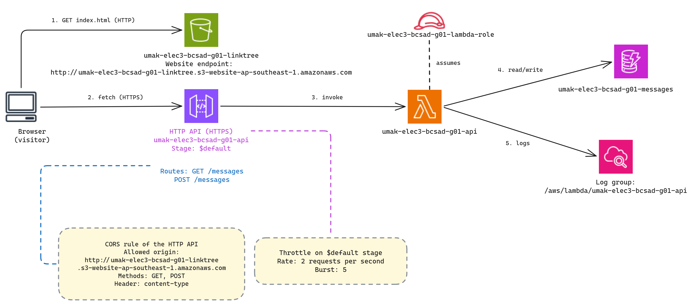

# Assignment 5 Submission

<!--
How to use this template:

1. Copy this file to submissions/assignment-5/group-<number>/submission.md
2. Replace every <answer> with your group's answer. Delete the angle brackets too.
3. Save diagram.png in the same folder.
4. Keep your invoke URL, your API ID, every ARN, and the account number out of this folder.
5. Write GitHub usernames, not full names or student numbers.
-->

## About us

- Group number: 1
- Section: IV-BCSAD
- Group IAM user: bcsad-g01

## Diagram

## Estimate

Asia Pacific (Singapore), one month: 100,000 page views and 5,000 posts.

| Service | Settings | Monthly cost (USD) |
| --- | --- | --- |
| Amazon S3 | S3 Standard, 1 GB, 100,000 GET requests | 0.07 |
| Amazon API Gateway | HTTP API, 0.105 million requests, 1 KB each | 0.13 |
| AWS Lambda | Without Free Tier, x86, 105,000 requests, 100 ms, 128 MB | 0.04 |
| Amazon DynamoDB | On-demand, Standard, 1 GB, 1 KB items, 0.005 million writes, 0.1 million eventually consistent reads | 0.29 |
| **Total** | | 0.53 |

Share link of our estimate: https://calculator.aws/#/estimate?id=a580fd28d74ea8f0db04b356796a02462d14e732

## Ten times the traffic

With 1,000,000 page views and 50,000 posts a month, which service's monthly cost grows the most in US dollars, and why?

Amazon API Gateway grows the most in US dollars. Its cost is almost entirely per request, so it scales with traffic. At 10 times the traffic it handles 1.05 million requests instead of 0.105 million, so its cost rises from 0.13 USD to about 1.3 USD, an increase of about 1.2 USD. Lambda also scales about 10 times, from 0.04 USD to about 0.4 USD, but it starts from a smaller number, so it adds fewer dollars. S3 goes from 0.07 USD to about 0.4 USD, and DynamoDB from 0.29 USD to only about 0.5 USD, because most of its cost is the fixed 1 GB of storage, which does not grow with traffic. The total rises from 0.53 USD to roughly 2.7 USD, and API Gateway is the largest share of that increase.

## The throttle and one more improvement

Which Well-Architected pillar does the throttle on the `$default` stage serve, and why?

The throttle serves the Reliability pillar. Limiting the stage to 2 requests per second with a burst of 5 stops a sudden flood of requests from overwhelming the Lambda function and the DynamoDB table. API Gateway answers the extra requests with 429 Too Many Requests, and the function does not run for them, so the guestbook keeps working for normal visitors. It also helps Cost Optimization, because it caps how many requests can be billed.

One more improvement for the same architecture, and the pillar that it serves:

Put Amazon CloudFront in front of the S3 bucket so the page is served over HTTPS instead of the plain HTTP website endpoint. This serves the Security pillar, because traffic between the visitor and the site is encrypted. It also improves Performance Efficiency, because CloudFront caches the page closer to visitors.

## Contribution

| GitHub username | What this groupmate did |
| --- | --- |
| mrkjeniel | Drew the architecture diagram with the AWS icons and exported diagram.png. |
| MalulanM | Did the AWS Pricing Calculator work and copied the share link. |
| JohnJhayAdriano | Wrote the answers for Task 3 and Task 4 and checked the totals. |
| qinglow | Wrote submission.md and opened the Pull Request. |