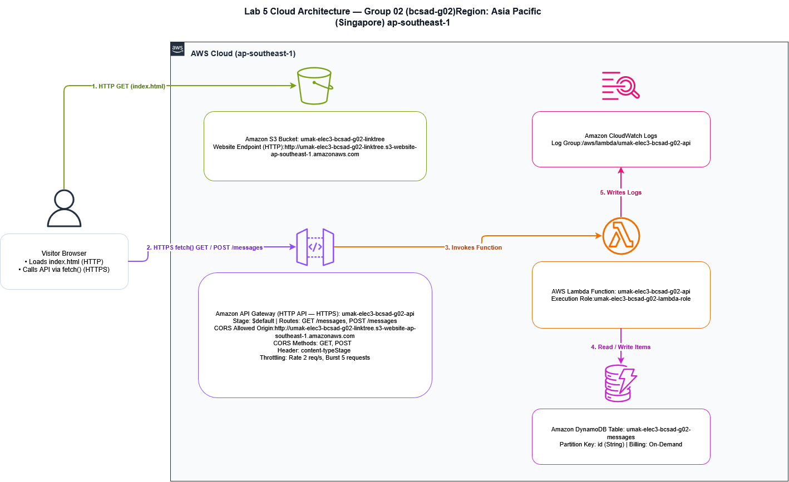

# Assignment 5 Submission

## About us

- Group number: `group-02`
- Section: `IV-BCSAD`
- Group IAM user: `bcsad-g02`

## Diagram

## Estimate

Asia Pacific (Singapore), one month: 100,000 page views and 5,000 posts.

| Service | Settings | Monthly cost (USD) |
| --- | --- | --- |
| Amazon S3 | S3 Standard, 1 GB, 100,000 GET requests | $0.07 |
| Amazon API Gateway | HTTP API, 0.105 million requests, 1 KB each | $0.13 |
| AWS Lambda | Without Free Tier, x86, 105,000 requests, 100 ms, 128 MB | $0.04 |
| Amazon DynamoDB | On-demand, Standard, 1 GB, 1 KB items, 0.005 million writes, 0.1 million eventually consistent reads | $0.29 |
| **Total** | | **$0.53** |

Share link of our estimate: https://calculator.aws/#/estimate?id=8e4551182111cc5c9e7d18c42354cdf66693b00c

## Ten times the traffic

With 1,000,000 page views and 50,000 posts a month, which service's monthly cost grows the most in US dollars, and why?

- **Amazon API Gateway** grows the most in US dollars, increasing by **$1.13/month** (from **$0.13** to **$1.26**). In Asia Pacific (Singapore), HTTP API requests cost **$1.20 per million**, so scaling 10× from 0.105 million to 1.05 million requests adds $0.945\text{ million} \times \$1.20 = \$1.13$. By contrast, the other services grow by smaller dollar amounts at 10× traffic: **AWS Lambda** increases by **$0.39** (from **$0.04** to **$0.43**, at $0.20/million requests and $0.0000166667 per GB-second), **Amazon S3** increases by **$0.36** (from **$0.07** to **$0.43**, since 1 GB storage stays flat at $0.025 and GET requests cost $0.0004 per 1,000), and **Amazon DynamoDB** increases by **$0.10** (from **$0.29** to **$0.39**, since 1 GB Standard storage stays flat at $0.285/GB-month while 0.05 million writes at ~$0.71/million and 1.0 million eventually consistent reads at $0.1425/million read request units scale 10×).

## The throttle and one more improvement

Which Well-Architected pillar does the throttle on the `$default` stage serve, and why?

- The stage throttle serves the **Reliability** pillar because enforcing a rate limit of 2 requests per second and a burst limit of 5 requests absorbs sudden traffic spikes and rejects excess requests (`429 Too Many Requests`) at the API Gateway layer before they can exhaust downstream AWS Lambda concurrency or DynamoDB throughput. *(It also supports **Cost Optimization** by blocking abusive request floods before they trigger paid Lambda invocations and DynamoDB operations.)*

One more improvement for the same architecture, and the pillar that it serves:

- Add **Amazon CloudFront** in front of the Amazon S3 website endpoint to deliver the site over **HTTPS** with edge caching and restrict direct public bucket access. This serves the **Security** pillar by encrypting visitor traffic in transit (HTTPS) and protecting the origin bucket, while also improving **Performance Efficiency** by caching static files at edge locations closer to visitors.

## Contribution

| GitHub username | What this groupmate did |
| --- | --- |
| justinecasiano | Designed and exported `diagram.png` using official AWS Architecture Icons and verified all group resource names |
| ExalaJohn | Configured the four services in the AWS Pricing Calculator for Asia Pacific (Singapore) and generated the share link |
| ShiftRedux | Calculated the 10× traffic cost scaling breakdown and verified calculator inputs against the assignment rubric |
| KennethTejam | Wrote the Well-Architected Framework answers and audited all files to ensure no API IDs, ARNs, or secrets were included |