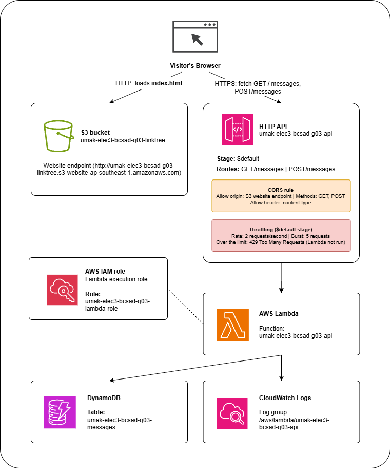

# Assignment 5 Submission

## About us

- Group number: 03
- Section: IV-BCSAD
- Group IAM user: bcsad-g03

## Diagram

## Estimate

Asia Pacific (Singapore), one month: 100,000 page views and 5,000 posts.

| Service | Settings | Monthly cost (USD) |
| --- | --- | --- |
| Amazon S3 | S3 Standard, 1 GB, 100,000 GET requests | 0.03 USD |
| Amazon API Gateway | HTTP API, 0.105 million requests, 1 KB each | 0.13 USD |
| AWS Lambda | Without Free Tier, x86, 105,000 requests, 100 ms, 128 MB | 0.04 USD |
| Amazon DynamoDB | On-demand, Standard, 1 GB, 1 KB items, 0.005 million writes, 0.1 million eventually consistent reads | 0.29 USD |
| **Total** | | 0.49 |

Share link of our estimate: https://calculator.aws/#/estimate?id=72fab46826992bd26e41045faed753e4e0c2e598

## Ten times the traffic

With 1,000,000 page views and 50,000 posts a month, which service's monthly cost grows the most in US dollars, and why?

The Amazon API Gateway cost is expected to grow the most in US dollars because it charges based on the number of API requests received. When our traffic increases from 105,000 to 1,050,000 requests per month, its estimated cost increases from around $0.13 to $1.30, or approximately $1.17 more per month. Although S3, Lambda, and DynamoDB costs will also increase as traffic grows, API Gateway has the largest estimated increase in our setup because of the higher number of API requests.

## The throttle and one more improvement

Which Well-Architected pillar does the throttle on the `$default` stage serve, and why?

The throttle serves the Reliability pillar because it limits the number of requests the API can receive at a time. With a rate limit of 2 requests per second and a burst limit of 5, it helps prevent the API and its backend services from becoming overloaded during sudden increases in traffic. This helps keep the application stable and available to users.

One more improvement for the same architecture, and the pillar that it serves:

One more improvement is to apply least-privilege permissions to the Lambda execution role. This supports the Security pillar because it ensures that the Lambda function only has access to the AWS resources and actions it needs. This helps reduce unnecessary access and protects the application and its data.

## Contribution

| GitHub username | What this groupmate did |
| --- | --- |
| JHnsu | Designed Lab 5 AWS architecture diagram, selected the required AWS services, and generated the shareable estimate link. |
| kdotvalentino | Led the AWS service configuration analysis, and verified the pricing assumptions and monthly cost calculations |
| shmoke4u | Helped prepare the written answers, and identify architecture improvements based on the AWS Well-Architected Framework |
