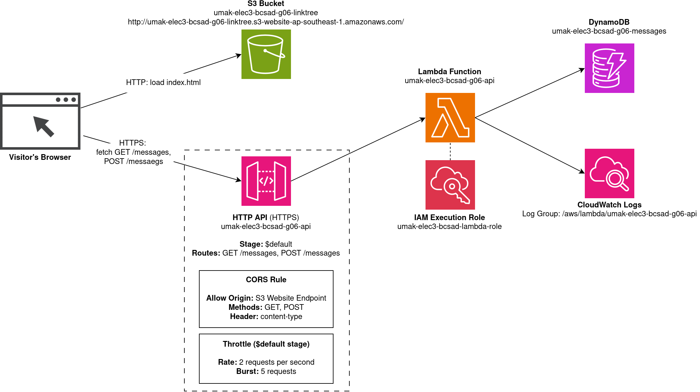

# Assignment 5 Submission

<!--
How to use this template:

1. Copy this file to submissions/assignment-5/group-<number>/submission.md
2. Replace every <answer> with your group's answer. Delete the angle brackets too.
3. Save diagram.png in the same folder.
4. Keep your invoke URL, your API ID, every ARN, and the account number out of this folder.
5. Write GitHub usernames, not full names or student numbers.
-->

## About us

- Group number: 6
- Section: IV-BCSAD
- Group IAM user: bcsad-g06

## Diagram

## Estimate

Asia Pacific (Singapore), one month: 100,000 page views and 5,000 posts.

| Service            | Settings                                                                                             | Monthly cost (USD) |
| ------------------ | ---------------------------------------------------------------------------------------------------- | ------------------ |
| Amazon S3          | S3 Standard, 1 GB, 100,000 GET requests                                                              | 0.07               |
| Amazon API Gateway | HTTP API, 0.105 million requests, 1 KB each                                                          | 0.13               |
| AWS Lambda         | Without Free Tier, x86, 105,000 requests, 100 ms, 128 MB                                             | 0.04               |
| Amazon DynamoDB    | On-demand, Standard, 1 GB, 1 KB items, 0.005 million writes, 0.1 million eventually consistent reads | 0.29               |
| **Total**          |                                                                                                      | 0.53               |

Share link of our estimate: https://calculator.aws/#/estimate?id=7d8d5868082188ae11c5c56687fbe57aeca1cb89

## Ten times the traffic

With 1,000,000 page views and 50,000 posts a month, which service's monthly cost grows the most in US dollars, and why?

With ten times the traffic, Amazon API Gateway grows the most, from about 0.13 to about 1.30 USD, an increase of about 1.17 USD. It charges per request, about 1.2 USD per million requests, and 1,050,000 requests cost ten times as much as 105,000. S3 grows by about 0.36 USD and Lambda by about 0.36 USD, because both also scale with requests. DynamoDB grows the least, by about 0.27 USD, because its 1 GB storage cost does not change and only its small read and write charges grow.

## The throttle and one more improvement

Which Well-Architected pillar does the throttle on the `$default` stage serve, and why?

The throttle serves the Reliability pillar (and also Cost Optimization). Limiting the stage to 2 requests per second with a burst of 5 stops a flood of requests from overwhelming the function and the table, so the site stays available, and it also caps how much a flood can cost.

One more improvement for the same architecture, and the pillar that it serves:

Restrict the CORS allowed origin and add an authorizer or API key on `POST /messages`, which serves the Security pillar. Only our site, and not bots, could then write messages to the table.

## Contribution

| GitHub username | What this groupmate did                                          |
| --------------- | ---------------------------------------------------------------- |
| gihyunx         | Managed the repository and drew the architecture diagram.        |
| samthology      | Priced the architecture in the AWS Pricing Calculator.           |
| samjoshuadud    | Wrote the answers for Task 3 and Task 4.                         |
| pruvk           | Checked the diagram, estimate, and share link before submission. |
