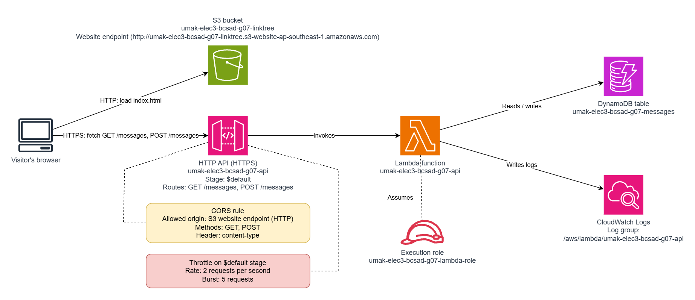

# Assignment 5 Submission

## About us

- Group number: 07
- Section: IV-BCSAD
- Group IAM user: bcsad-g07

## Diagram

## Estimate

Asia Pacific (Singapore), one month: 100,000 page views and 5,000 posts.

| Service | Settings | Monthly cost (USD) |
| --- | --- | --- |
| Amazon S3 | S3 Standard, 1 GB, 100,000 GET requests | 0.07 |
| Amazon API Gateway | HTTP API, 0.105 million requests, 1 KB each | 0.13 |
| AWS Lambda | Without Free Tier, x86, 105,000 requests, 100 ms, 128 MB | 0.04 |
| Amazon DynamoDB | On-demand, Standard, 1 GB, 1 KB items, 0.005 million writes, 0.1 million eventually consistent reads | 0.29 |
| **Total** | | 0.53 |

Share link of our estimate: https://calculator.aws/#/estimate?id=d448918dfcba3a3f6aae94d53e636dbdbadee1ac

## Ten times the traffic

With 1,000,000 page views and 50,000 posts a month, which service's monthly cost grows the most in US dollars, and why?

- Amazon API Gateway grows the most. Its monthly cost increases from approximately 0.13 USD to 1.26 USD, an increase of approximately 1.13 USD. This is because its HTTP API pricing is primarily based on the number of requests, so increasing traffic from 105,000 to 1,050,000 requests directly increases its cost. S3 and Lambda also increase with traffic, but their per-request costs are lower, resulting in increases of approximately 0.36-0.40 USD each. DynamoDB increases less because its 1 GB storage cost remains unchanged, while only its read and write request costs increase.

## The throttle and one more improvement

Which Well-Architected pillar does the throttle on the `$default` stage serve, and why?

- Reliability. The throttle (2 requests per second, burst 5) stops a sudden spike or abusive client from overwhelming the API, the Lambda function, and the DynamoDB table. API Gateway answers extra requests with 429 Too Many Requests and the function does not run for them, so the system keeps working for normal visitors. It also keeps the cost from growing out of control.

One more improvement for the same architecture, and the pillar that it serves:

- Put Amazon CloudFront in front of the S3 bucket. It caches `index.html` close to visitors, which loads the page faster for people far from Singapore. This serves the Performance Efficiency pillar.

## Contribution

| GitHub username | What this groupmate did |
| --- | --- |
| Dan-Ike | Drew diagram.png, created the AWS Pricing Calculator estimate. |
| abijeyn | Checked the 10× traffic calculations in the calculator and wrote or edited the "Ten Times the Traffic" answer. |
| StarMirai | Reviewed the six Well-Architected pillars, confirmed the throttle's pillar, and selected and explained one additional improvement. |
| o4o29 | Checked the estimate's share link in a private browser window, verified that the submission folder contained no invoke URL, API ID, ARN, or account number. |
