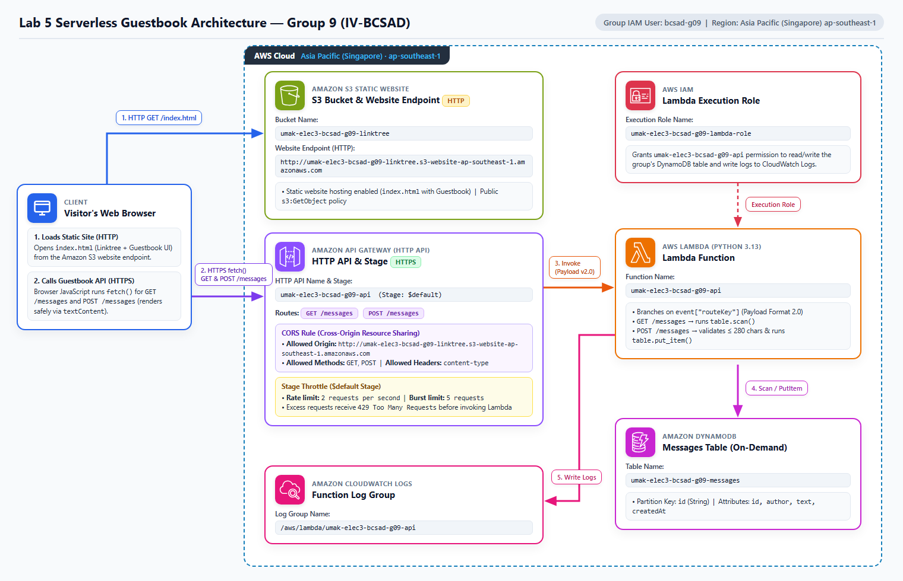

# Assignment 5 Submission

<!--
How to use this template:

1. Copy this file to submissions/assignment-5/group-<number>/submission.md
2. Replace every <answer> with your group's answer. Delete the angle brackets too.
3. Save diagram.png in the same folder.
4. Keep your invoke URL, your API ID, every ARN, and the account number out of this folder.
5. Write GitHub usernames, not full names or student numbers.
-->

## About us

- Group number: 9
- Section: IV-BCSAD
- Group IAM user: bcsad-g09

## Diagram

## Estimate

Asia Pacific (Singapore), one month: 100,000 page views and 5,000 posts.

| Service            | Settings                                                                                             | Monthly cost (USD) |
| ------------------ | ---------------------------------------------------------------------------------------------------- | ------------------ |
| Amazon S3          | S3 Standard, 1 GB, 100,000 GET requests                                                              | 0.07               |
| Amazon API Gateway | HTTP API, 0.105 million requests, 1 KB each                                                          | 0.13               |
| AWS Lambda         | Without Free Tier, x86, 105,000 requests, 100 ms, 128 MB                                             | 0.04               |
| Amazon DynamoDB    | On-demand, Standard, 1 GB, 1 KB items, 0.005 million writes, 0.1 million eventually consistent reads | 0.30               |
| **Total**          |                                                                                                      | 0.54               |

Share link of our estimate: https://calculator.aws/#/estimate?id=df91afde69c92dfd86a5c700f1360201f5342851

## Ten times the traffic

With 1,000,000 page views and 50,000 posts a month, which service's monthly cost grows the most in US dollars, and why?

**Amazon API Gateway's** monthly cost grows the most in US dollars—rising from **0.13 USD** (at 0.105 million requests) to **1.31 USD** (at 1.05 million requests), an increase of **+1.18 USD/month**. This happens because 100% of API Gateway's cost is billed per request (1.25 USD per million HTTP API requests in Singapore) and has the highest per-request unit price among the four services, whereas most of DynamoDB's 0.30 USD bill (0.29 USD for 1 GB of storage) and nearly half of S3's 0.07 USD bill (0.03 USD for 1 GB of storage) are fixed storage charges that do not multiply by ten when traffic grows (at 10x traffic, AWS Lambda grows by only +0.39 USD from 0.04 USD to 0.43 USD, S3 GET requests grow by +0.36 USD from 0.04 USD to 0.40 USD, and DynamoDB read/write requests grow by only +0.10 USD).

## The throttle and one more improvement

Which Well-Architected pillar does the throttle on the `$default` stage serve, and why?

The throttle on the `$default` stage (rate limit of 2 requests per second, burst limit of 5 requests) serves the **Reliability** pillar (alongside **Security** and **Cost Optimization**) because it uses a token bucket to reject sudden traffic spikes or abusive scripts at the API Gateway edge with `429 Too Many Requests` before they invoke our Lambda function, preventing backend overload and protecting our database and budget for legitimate visitors.

One more improvement for the same architecture, and the pillar that it serves:

Adding **Amazon CloudFront** with Origin Access Control (OAC) in front of our `umak-elec3-bcsad-g09-linktree` S3 bucket—and replacing `table.scan()` in `GET /messages` with a paginated DynamoDB `Query` for only the newest 50 messages—serves the **Security**, **Performance Efficiency**, and **Cost Optimization** pillars by delivering the website over **HTTPS** with low-latency edge caching while keeping the S3 bucket private and preventing DynamoDB read costs from growing linearly as old messages accumulate.

## Contribution

| GitHub username | What this groupmate did                                                                                   |
| --------------- | --------------------------------------------------------------------------------------------------------- |
| jyjstn          | Designed the Lab 5 architecture diagram (`diagram.png`) with official AWS icons, routes, CORS, & throttle |
| Dyeel           | Configured the four Singapore services in the AWS Pricing Calculator and generated the public share link  |
| Ychannn29       | Calculated and wrote the 10x traffic cost-growth analysis comparing API Gateway, Lambda, S3, and DynamoDB |
| korbin88        | Wrote the Well-Architected pillar analysis for stage throttling and architectural improvements for the PR |

