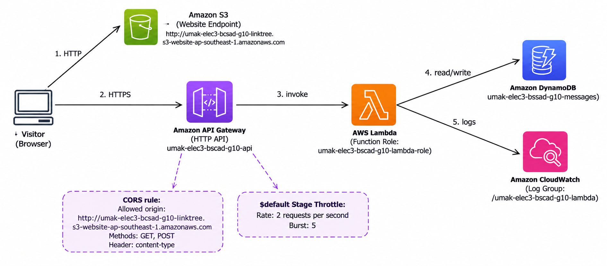

# Assignment 5 Submission

<!--
How to use this template:

1. Copy this file to submissions/assignment-5/group-<number>/submission.md
2. Replace every <answer> with your group's answer. Delete the angle brackets too.
3. Save diagram.png in the same folder.
4. Keep your invoke URL, your API ID, every ARN, and the account number out of this folder.
5. Write GitHub usernames, not full names or student numbers.
-->

## About us

- Group number: 10
- Section: IV - BCSAD
- Group IAM user: bcsad-g10

## Diagram

## Estimate

Asia Pacific (Singapore), one month: 100,000 page views and 5,000 posts.

| Service | Settings | Monthly cost (USD) |
| --- | --- | --- |
| Amazon S3 | S3 Standard, 1 GB, 100,000 GET requests | 0.07 USD |
| Amazon API Gateway | HTTP API, 0.105 million requests, 1 KB each | 0.13 USD |
| AWS Lambda | Without Free Tier, x86, 105,000 requests, 100 ms, 128 MB | 0.04 USD |
| Amazon DynamoDB | On-demand, Standard, 1 GB, 1 KB items, 0.005 million writes, 0.1 million eventually consistent reads | 0.29 USD |
| **Total** | | 0.53 USD |

Share link of our estimate: https://calculator.aws/#/estimate?id=4968bcfd9b90a07165bdf4a563644798df4cbd9a

## Ten times the traffic

With 1,000,000 page views and 50,000 posts a month, which service's monthly cost grows the most in US dollars, and why?

When traffic increases to 1,000,000 page views and 50,000 posts per month, Amazon API Gateway has the highest monthly cost, reaching approximately USD 1.31. This is because the increase in website traffic results in more HTTP API requests being processed, which increases the charges for API Gateway. As the number of requests grows, the cost of handling those requests also increases. The higher traffic increases the number of operations handled by the architecture, which results in higher usage-based costs.

## The throttle and one more improvement

Which Well-Architected pillar does the throttle on the `$default` stage serve, and why?

The throttle supports the Reliability pillar because it limits incoming API requests to 2 requests per second with a burst capacity of 5. This helps prevent sudden traffic spikes from overwhelming the backend services and reduces the risk of service interruptions. As a result, the application can remain available and handle requests more consistently.

One more improvement for the same architecture, and the pillar that it serves:

One additional improvement is to apply the principle of least privilege to the Lambda execution role. The role should only have permission to access the required DynamoDB table and send logs to CloudWatch Logs. This supports the Security pillar because limiting permissions reduces unnecessary access and helps protect the application's resources.

## Contribution

| GitHub username | What this groupmate did |
| --- | --- |
| ambv13 | Created the AWS architecture diagram, configured Amazon S3 in the AWS Pricing Calculator, and compiled the group's final submission. |
| CANLASpogi | Configured Amazon API Gateway, checked the HTTP API request assumptions, and recorded its estimated monthly cost. |
| DrMacky | Configured AWS Lambda and Amazon DynamoDB, verified their settings, and recorded their estimated monthly costs. |
| Kopibean101223 | Reviewed the pricing estimates, evaluated the 10× traffic cost increase, and helped prepare the Well-Architected answers. |

