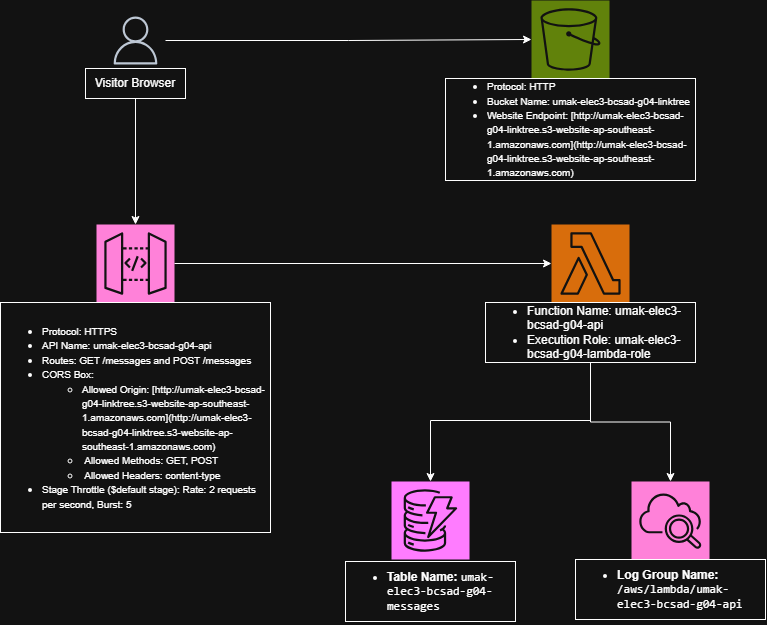

# Assignment 5 Submission

<!--
How to use this template:

1. Copy this file to submissions/assignment-5/group-<number>/submission.md
2. Replace every <answer> with your group's answer. Delete the angle brackets too.
3. Save diagram.png in the same folder.
4. Keep your invoke URL, your API ID, every ARN, and the account number out of this folder.
5. Write GitHub usernames, not full names or student numbers.
-->

## About us

- Group number: 4
- Section: IV-BCSAD
- Group IAM user: bcsad-g04

## Diagram

## Estimate

Asia Pacific (Singapore), one month: 100,000 page views and 5,000 posts.

| Service | Settings | Monthly cost (USD) |
| --- | --- | --- |
| Amazon S3 | S3 Standard, 1 GB, 100,000 GET requests | 0.07 |
| Amazon API Gateway | HTTP API, 0.105 million requests, 1 KB each | 0.11 |
| AWS Lambda | Without Free Tier, x86, 105,000 requests, 100 ms, 128 MB | 0.04 |
| Amazon DynamoDB | On-demand, Standard, 1 GB, 1 KB items, 0.005 million writes, 0.1 million eventually consistent reads | 0.28 |
| **Total** | | 0.50 |

Share link of our estimate: https://calculator.aws/#/estimate?id=a6318cb33bf7290ff30beba3a78326f7203995c3

## Ten times the traffic

With 1,000,000 page views and 50,000 posts a month, which service's monthly cost grows the most in US dollars, and why?

Amazon API Gateway's monthly cost grows the most in US dollars. At ten times the traffic (1,050,000 requests per month), API Gateway costs increase from $0.11 to $1.05 (a total dollar growth of ~$0.94). By comparison, S3 GET request costs increase by ~$0.39, Lambda execution costs increase by ~$0.39, and DynamoDB read/write request costs increase by ~$0.28. API Gateway grows the most in total dollars because HTTP APIs charge a rate of $1.00 per million request units, whereas the unit pricing rates per request for S3, Lambda, and DynamoDB reads/writes are significantly lower at this volume scale.

## The throttle and one more improvement

Which Well-Architected pillar does the throttle on the `$default` stage serve, and why?

The throttle (rate 2 requests per second, burst 5) serves the **Reliability** pillar. It protects downstream serverless components (AWS Lambda and Amazon DynamoDB) from being overloaded by traffic spikes or denial-of-service attacks, keeping the service operational and preventing execution quota exhaustion.

One more improvement for the same architecture, and the pillar that it serves:

Adding **Amazon CloudFront** in front of the Amazon S3 website endpoint serves the **Performance Efficiency** pillar (and the **Security** pillar). CloudFront caches static files (`index.html`) at edge locations worldwide to minimize latency for users and provides free HTTPS encryption for static web content.

## Contribution

| GitHub username | What this groupmate did |
| --- | --- |
| ctrl-amed | Initialized Git branch, managed folder structure, committed changes, and created PR |
| angeluuhh | Configured AWS Pricing Calculator estimate for S3, API Gateway, Lambda, and DynamoDB |
| leksxee | Designed Task 1 architecture diagram with AWS icons and saved diagram.png |
| Jajaalbaladejo27-sys | Drafted Well-Architected pillar explanations, verified links, and completed Google Form |