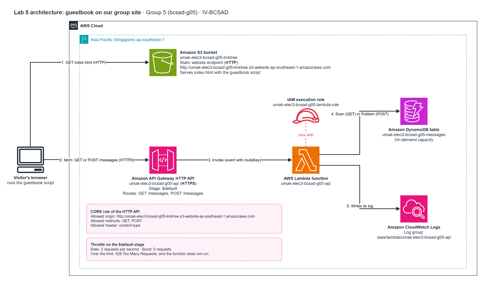

# Assignment 5 Submission

## About us

- Group number: 5
- Section: IV-BCSAD
- Group IAM user: bcsad-g05

## Diagram

## Estimate

Asia Pacific (Singapore), one month: 100,000 page views and 5,000 posts.

| Service | Settings | Monthly cost (USD) |
| --- | --- | --- |
| Amazon S3 | S3 Standard, 1 GB, 100,000 GET requests | 0.07 |
| Amazon API Gateway | HTTP API, 0.105 million requests, 1 KB each | 0.13 |
| AWS Lambda | Without Free Tier, x86, 105,000 requests, 100 ms, 128 MB | 0.04 |
| Amazon DynamoDB | On-demand, Standard, 1 GB, 1 KB items, 0.005 million writes, 0.1 million eventually consistent reads | 0.29 |
| **Total** | | **0.53** |

Share link of our estimate: <https://calculator.aws/#/estimate?id=85bd621d04b1e1d48cdc6a801f087d2e4f60d49e>

## Ten times the traffic

With 1,000,000 page views and 50,000 posts a month, which service's monthly cost grows the most in US dollars, and why?

Amazon API Gateway grows the most. It charges about 1.25 USD per million requests, and every one of the 1,050,000 requests goes through it, so its cost goes from about 0.13 USD to about 1.31 USD, an increase of about 1.18 USD. Lambda grows by about 0.39 USD (about 0.20 USD per million requests plus the compute time of each run), and S3 by about 0.36 USD (about 0.0004 USD per 1,000 GET requests). DynamoDB grows the least, by about 0.10 USD, because most of its cost is the 1 GB of storage, which does not grow with traffic, and each eventually consistent read of a 1 KB item costs only half a read request unit. In practice, DynamoDB would grow faster than this, because our `GET /messages` route uses Scan and reads every message in the table, so each GET reads more as the guestbook fills up.

## The throttle and one more improvement

Which Well-Architected pillar does the throttle on the `$default` stage serve, and why?

Reliability. Our page is public and its source shows our invoke URL, so anyone can flood the API. The throttle lets through only 2 requests per second, with a burst of 5, and answers the rest with `429 Too Many Requests` before they reach Lambda and DynamoDB, so a flood cannot overload the function or the table and the guestbook keeps working for real visitors. Throttling requests to protect a workload is one of the best practices of the Reliability pillar.

One more improvement for the same architecture, and the pillar that it serves:

Put Amazon CloudFront in front of the S3 bucket, so that visitors open the site over HTTPS instead of HTTP. The page and the messages that visitors type are then encrypted between the browser and AWS. This serves the Security pillar, which asks us to protect data in transit.

## Contribution

| GitHub username | What this groupmate did |
| --- | --- |
| ehrickkk | Drew the architecture diagram with the AWS icons, priced all four services in the AWS Pricing Calculator, created the share link, and wrote the answer about ten times the traffic |
| LouieCads | Checked the names of our bucket, API, function, role, table, and log group in the diagram against our Seatwork 3 and Lab 4 resources |
| sonisunn | Checked every field of the estimate against the assignment, including on-demand capacity for DynamoDB and millions as the API Gateway unit |
| MeinardEdrei | Wrote the answer about the throttle and the extra improvement, checked that no file shows an invoke URL, API ID, ARN, or account number, and submitted the Pull Request link in the Google Form |
