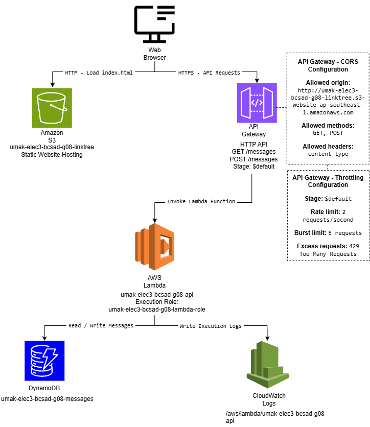

# Assignment 5 Submission

<!--
How to use this template:

1. Copy this file to submissions/assignment-5/group-<number>/submission.md
2. Replace every <answer> with your group's answer. Delete the angle brackets too.
3. Save diagram.png in the same folder.
4. Keep your invoke URL, your API ID, every ARN, and the account number out of this folder.
5. Write GitHub usernames, not full names or student numbers.
-->

## About us

- Group number: 08
- Section: IV-BCSAD
- Group IAM user: bcsad-g08

## Diagram

## Estimate

Asia Pacific (Singapore), one month: 100,000 page views and 5,000 posts.

| Service | Settings | Monthly cost (USD) |
| --- | --- | ---: |
| Amazon S3 | S3 Standard, 1 GB, 100,000 GET requests | $0.07 |
| Amazon API Gateway | HTTP API, 0.105 million requests, 1 KB each | $0.04 |
| AWS Lambda | Without Free Tier, x86, 105,000 requests, 100 ms, 128 MB | $0.13 |
| Amazon DynamoDB | On-demand, Standard, 1 GB, 1 KB items, 0.005 million writes, 0.1 million eventually consistent reads | $0.29 |
| **Total** | | **$0.53** |

Share link of our estimate: https://calculator.aws/#/estimate?utm_source=chatgpt.com&id=0c2b0a7059b8b4d67f06c43a9fb2d01e721fc205

## Ten times the traffic

With 1,000,000 page views and 50,000 posts a month, which service's monthly cost grows the most in US dollars, and why?

Amazon API Gateway has the largest cost increase. Its monthly cost increases from $0.04 to $1.31, which is a $1.27 increase. This is because the number of HTTP API requests increases from 105,000 to 1,050,000 per month as traffic grows ten times.

## The throttle and one more improvement

Which Well-Architected pillar does the throttle on the `$default` stage serve, and why?

The throttle serves the Reliability pillar because it limits incoming API requests to help prevent the system from being overwhelmed during sudden traffic spikes. It also helps maintain API availability by returning a 429 Too Many Requests response when the rate or burst limit is exceeded.

One more improvement for the same architecture, and the pillar that it serves:

One more improvement is to configure Amazon CloudWatch alarms to monitor Lambda errors, API Gateway 5xx errors, and request traffic. This serves the Operational Excellence pillar because it helps the team monitor system performance, detect issues early, and respond to problems before they affect users.

## Contribution

| GitHub username | What this groupmate did |
| --- | --- |
| <answer> | <answer> |
| <answer> | <answer> |
| <answer> | <answer> |
