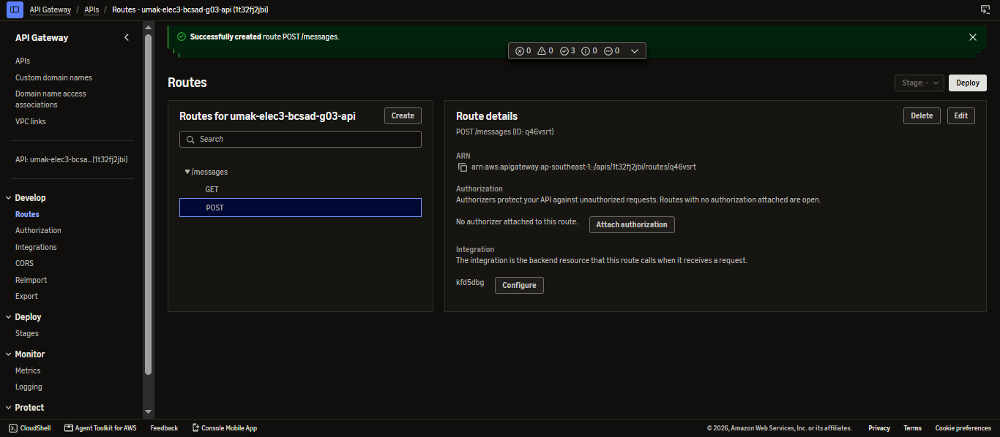
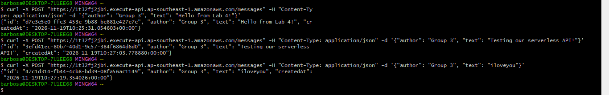
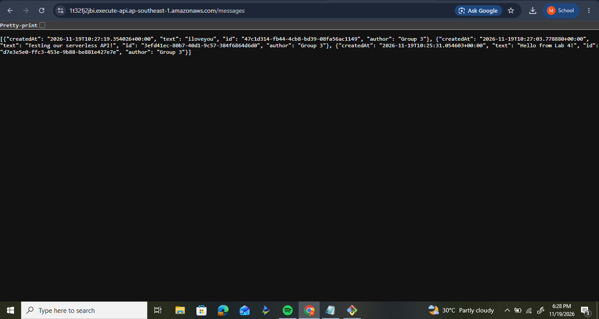
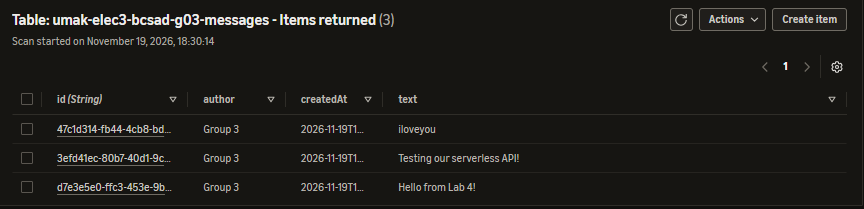

# Lab 4 Submission

## About us

- Group number: 3
- Section: IV-BCSAD
- Group IAM user: bcsad-g03
- DynamoDB table name: `umak-elec3-bcsad-g03-messages`
- HTTP API name: `umak-elec3-bcsad-api`

## Handler code

```python
import base64
import json
import uuid
from datetime import datetime, timezone

import boto3

GROUP_NAME = "Group 3 of IV-BCSAD"
TABLE_NAME = "umak-elec3-bcsad-g03-messages"

table = boto3.resource("dynamodb").Table(TABLE_NAME)


def respond(status_code, body):
    return {
        "statusCode": status_code,
        "headers": {"Content-Type": "application/json"},
        "body": json.dumps(body),
    }


def read_json_body(event):
    body = event.get("body") or "{}"
    if event.get("isBase64Encoded"):
        body = base64.b64decode(body).decode("utf-8")
    return json.loads(body)


def lambda_handler(event, context):
    route = event.get("routeKey")

    if route == "GET /messages":
        items = table.scan()["Items"]
        return respond(200, items)

    if route == "POST /messages":
        try:
            data = read_json_body(event)
        except ValueError:
            data = None
        if not isinstance(data, dict) or not data.get("text"):
            return respond(400, {"error": "Send a JSON body with a text field."})
        if len(str(data["text"])) > 280:
            return respond(400, {"error": "Keep the text at 280 characters or fewer."})
        message = {
            "id": str(uuid.uuid4()),
            "author": str(data.get("author") or GROUP_NAME)[:80],
            "text": str(data["text"]),
            "createdAt": datetime.now(timezone.utc).isoformat(),
        }
        table.put_item(Item=message)
        return respond(201, message)

    return respond(404, {"error": f"No route for {route}"})
```

## Screenshots









## Questions

### 1. Both routes call the same function. How does your code know which route a request came through?

The code uses `event.get("routeKey")` to identify which route the request came through. It checks whether the request is `GET /messages` or `POST /messages` and executes the corresponding code.

### 2. What answer do you get when you open the invoke URL without `/messages`? Why does API Gateway answer this way, and not your function?

It returns `{"message":"Not Found"}` because there is no route configured for the root path. API Gateway checks the requested route and returns a 404 Not Found response before invoking the Lambda function.

### 3. Your GET /messages route uses Scan. What happens to the cost of each GET request as the table grows to thousands of messages? Why?

As the DynamoDB table grows, Scan reads more items to retrieve the data. This increases read capacity consumption, cost, and response time, making Scan less efficient for larger tables.