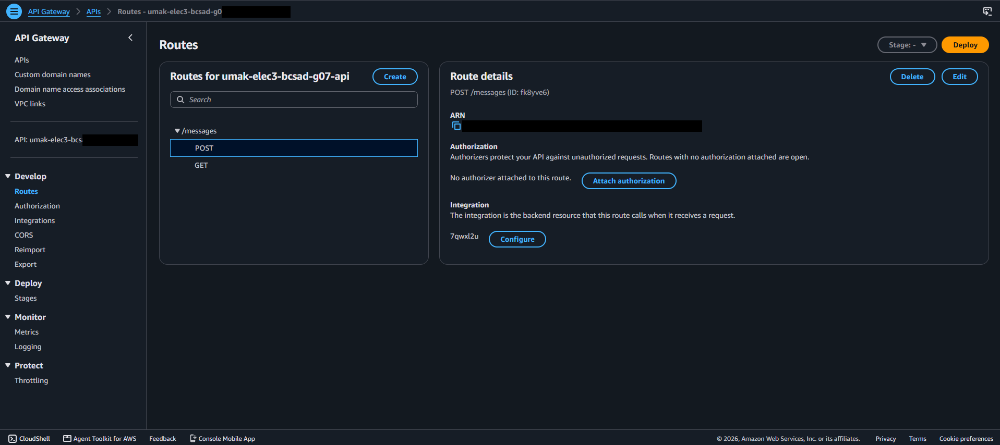
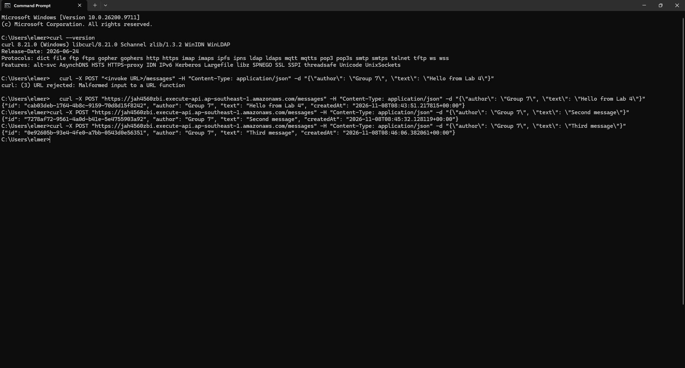
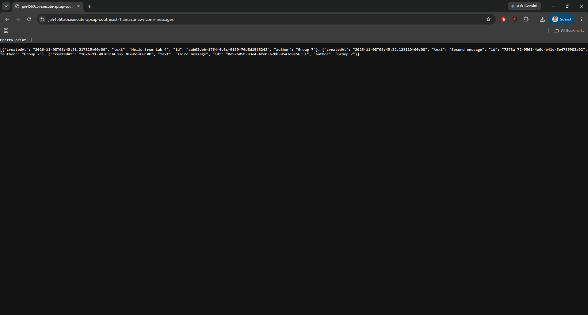
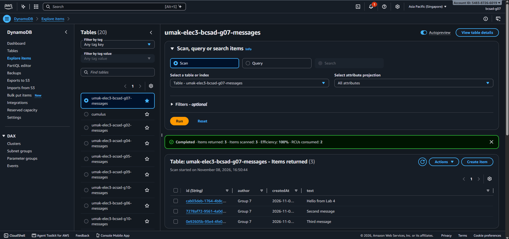

# Lab 4 Submission

<!--
How to use this template:

1. Copy this file to submissions/lab-4/group-<number>/submission.md
2. Replace every <answer> with your group's answer. Delete the angle brackets too.
3. Save routes.png, post.png, get.png, and items.png in the same folder.
4. Crop the AWS console top bar out of routes.png and items.png, and cover every ARN.
5. Cover your API ID, the part between https:// and .execute-api, in routes.png, post.png, and get.png. Your invoke URL goes only in the Google Form, never in this repository.
6. Do not write full names or student numbers in this file.
-->

## About us

- Group number: 07
- Section: IV-BCSAD
- Group IAM user: bcsad-g07
- DynamoDB table name: umak-elec3-bcsad-g07-messages
- HTTP API name: umak-elec3-bcsad-g07-api

## Handler code

```python
import base64
import json
import uuid
from datetime import datetime, timezone

import boto3

GROUP_NAME = "Group 4 of IV-BCSAD"  # Keep your group's name from Seatwork 4.
TABLE_NAME = "umak-elec3-bcsad-g07-messages"  # Change acsad-g03 to your group IAM user.

table = boto3.resource("dynamodb").Table(TABLE_NAME)


def respond(status_code, body):
    return {
        "statusCode": status_code,
        "headers": {"Content-Type": "application/json"},
        "body": json.dumps(body),
    }


def read_json_body(event):
    body = event.get("body") or "{}"
    if event.get("isBase64Encoded"):
        body = base64.b64decode(body).decode("utf-8")
    return json.loads(body)


def lambda_handler(event, context):
    route = event.get("routeKey")

    if route == "GET /messages":
        items = table.scan()["Items"]
        return respond(200, items)

    if route == "POST /messages":
        try:
            data = read_json_body(event)
        except ValueError:
            data = None
        if not isinstance(data, dict) or not data.get("text"):
            return respond(400, {"error": "Send a JSON body with a text field."})
        if len(str(data["text"])) > 280:
            return respond(400, {"error": "Keep the text at 280 characters or fewer."})
        message = {
            "id": str(uuid.uuid4()),
            "author": str(data.get("author") or GROUP_NAME)[:80],
            "text": str(data["text"]),
            "createdAt": datetime.now(timezone.utc).isoformat(),
        }
        table.put_item(Item=message)
        return respond(201, message)

    return respond(404, {"error": f"No route for {route}"})
```

## Screenshots









## Questions

1. Both routes call the same function. How does your code know which route a request came through?

   - API Gateway puts the route that matched in the event, in the field `routeKey`, for example `"GET /messages"` or `"POST /messages"`.
   - Our handler reads it with `event.get("routeKey")` and uses `if` statements to run the matching code: a Scan for `GET /messages` and a PutItem for `POST /messages`.
   - Any other value returns a 404 with the message "No route for ...".

2. What answer do you get when you open the invoke URL without `/messages`? Why does API Gateway answer this way, and not your function?

   - We get `{"message":"Not Found"}` with HTTP status 404.
   - Our API only has two routes, `GET /messages` and `POST /messages`, and the root path matches neither of them.
   - API Gateway checks the routes first and rejects a request that matches none, so the request never reaches the Lambda function and our code never runs.

3. Your `GET /messages` route uses Scan. What happens to the cost of each GET request as the table grows to thousands of messages? Why?

   - The cost of each GET request goes up as the table grows.
   - Scan reads every item in the table, and DynamoDB on-demand charges for the amount of data read, so a bigger table means more data read and a higher cost for every single GET.
   - The function also takes longer to run and returns a bigger response, so the Lambda and response costs grow too.
   - This is different from a small table, where one GET reads only a few items.
