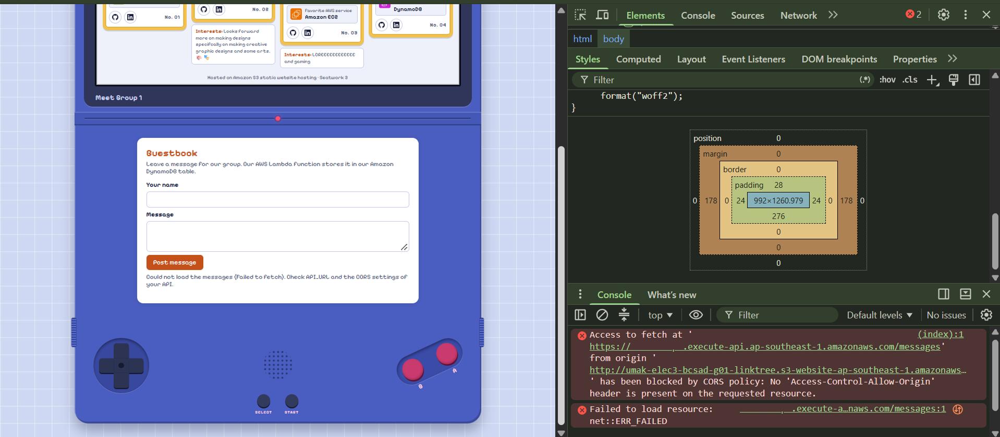
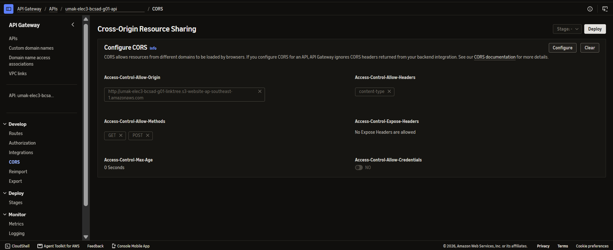
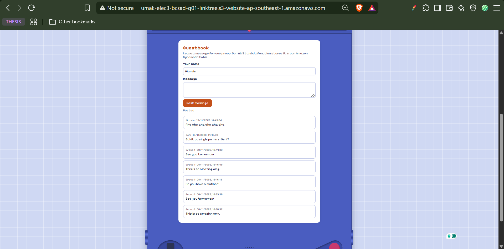
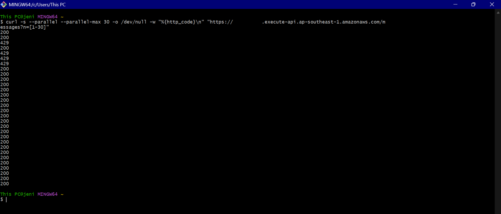

# Lab 5 Submission

<!--
How to use this template:

1. Copy this file to submissions/lab-5/group-<number>/submission.md
2. Replace every <answer> with your group's answer. Delete the angle brackets too.
3. Save cors-error.png, cors.png, site.png, and throttle.png in the same folder.
4. Crop the AWS console top bar out of cors.png, and cover every ARN.
5. Cover your API ID, the part between https:// and .execute-api, in cors-error.png, cors.png, and throttle.png.
6. Do not add your index.html. It holds your invoke URL.
7. Do not write full names or student numbers in this file.
-->

## About us

- Group number: 1
- Section: IV-BCSAD
- Group IAM user: bcsad-g01
- Website endpoint: http://umak-elec3-bcsad-g01-linktree.s3-website-ap-southeast-1.amazonaws.com
- HTTP API name: umak-elec3-bcsad-g01-linktree

## Screenshots

## Questions

1. In Lab 4, your API answered `curl` and the address bar of your browser. In Step 3, the same API did not answer your page. Why?

   The browser blocked our page, not the API. CORS is a browser rule for scripts that run on a page, and `curl` and the address bar are not scripts on a page, so they ignore it. Our page (`http` on the S3 host) and our API (`https` on the `execute-api` host) are different origins, and the API had not yet allowed our site in its CORS settings, so the browser would not let the page read the answer.

2. Which pillar of the AWS Well-Architected Framework does your throttle serve? Explain in two sentences.

   The throttle serves the Reliability pillar. It limits the stage to 2 requests per second with a burst of 5, so a flood of requests cannot overload our Lambda function and DynamoDB table, and the API keeps working for normal visitors.

3. Your guestbook shows each message with `textContent`. What could a visitor do if the page put each message into the page as HTML with `innerHTML`?

   A visitor could post HTML or JavaScript as a message, for example an `` tag with an `onerror` handler. With `innerHTML`, the browser would read it as real code and run it in the browser of everyone who opens the guestbook. That could steal data, redirect visitors to another site, or change how our page looks.
