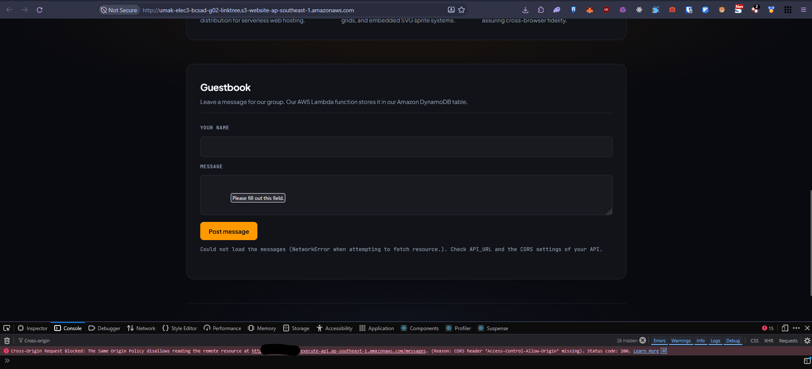
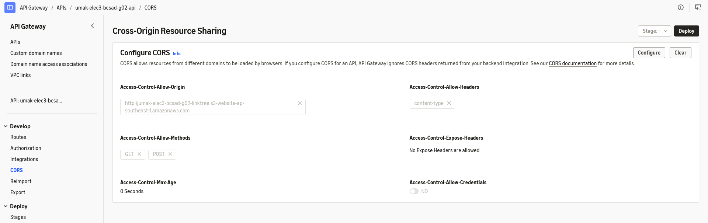
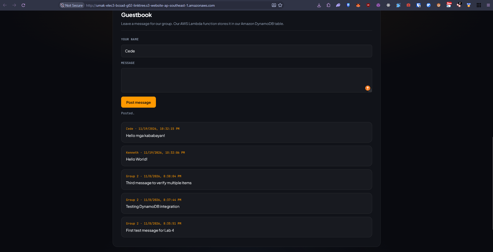
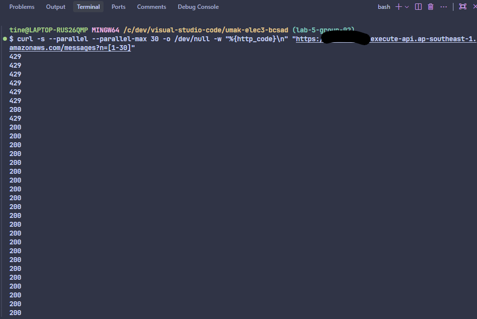

# Lab 5 Submission

## About us

- Group number: `group-02`
- Section: `IV-BCSAD`
- Group IAM user: `bcsad-g02`
- Website endpoint: `http://umak-elec3-bcsad-g02-linktree.s3-website-ap-southeast-1.amazonaws.com`
- HTTP API name: `umak-elec3-bcsad-g02-api`

## Screenshots

## Questions

1. In Lab 4, your API answered `curl` and the address bar of your browser. In Step 3, the same API did not answer your page. Why?

- `CORS (Cross-Origin Resource Sharing) is a security rule enforced strictly by web browsers for scripts (like fetch) making requests across different origins, it does not apply to curl or typing a URL directly into the address bar. Because our S3 website (http://...s3-website...) and our API Gateway endpoint ([https://...execute-api](https://...execute-api)...) have different schemes and hosts, the browser blocked the page from reading the API's response until we explicitly configured Access-Control-Allow-Origin on our API to permit our site.`

2. Which pillar of the AWS Well-Architected Framework does your throttle serve? Explain in two sentences.

- `The throttle serves the Reliability pillar (specifically mitigating distributed denial-of-service or sudden traffic spikes to prevent resource exhaustion). By enforcing a rate and burst limit at the API Gateway layer, it absorbs sudden floods of requests and prevents downstream services like our Lambda function and DynamoDB table from being overwhelmed, ensuring the API stays available for legitimate visitors.`

3. Your guestbook shows each message with `textContent`. What could a visitor do if the page put each message into the page as HTML with `innerHTML`?

- `A visitor could perform a Stored Cross-Site Scripting (XSS) attack by submitting a message containing malicious HTML or JavaScript (such as <script> tags or an  tag with an onerror attribute). Using innerHTML would cause the browser to parse and execute that injected code inside the session of anyone who loads the guestbook, potentially defacing the page, redirecting users, or stealing browser data.`
