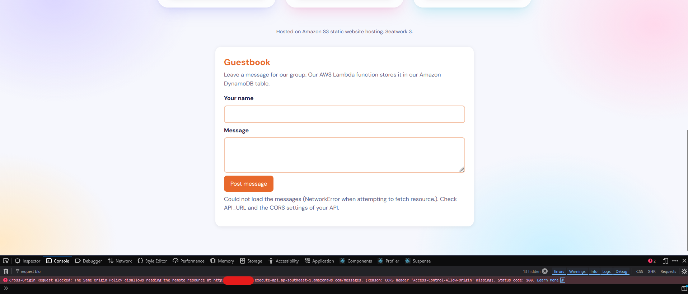
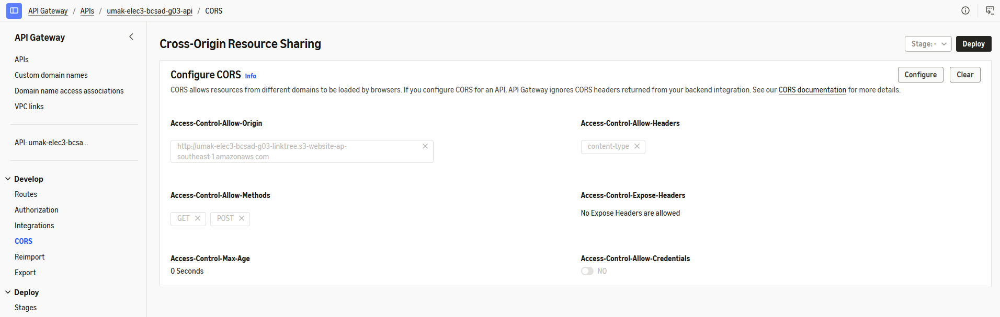
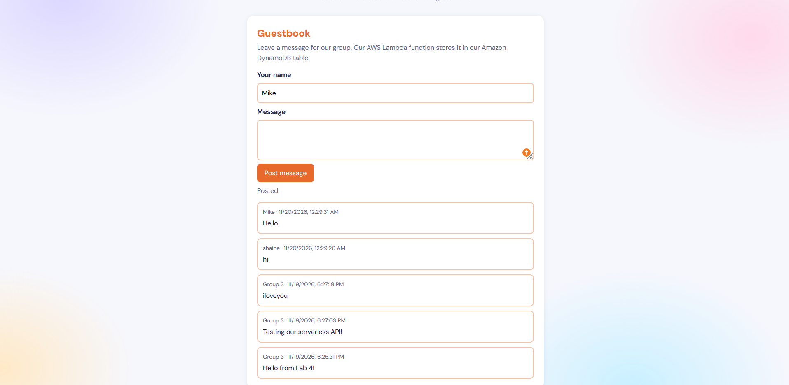
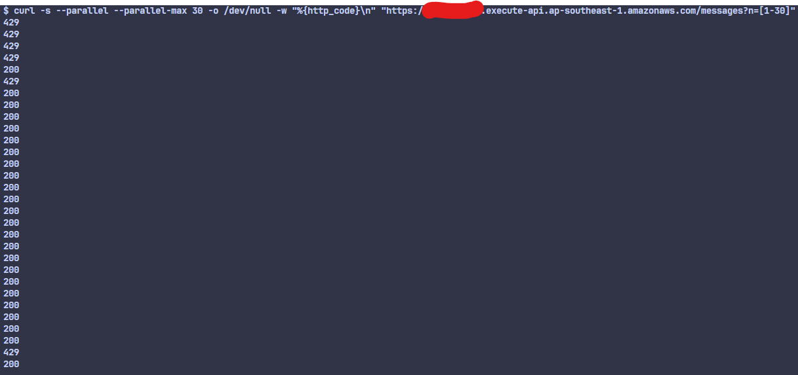

# Lab 5 Submission

## About us

- Group number: group-03
- Section: IV-BCSAD
- Group IAM user: bcsad-g03
- Website endpoint: http://umak-elec3-bcsad-g03-linktree.s3-website-ap-southeast-1.amazonaws.com
- HTTP API name: umak-elec3-bcsad-g03-api

## Screenshots

## Questions

1. In Lab 4, your API answered `curl` and the address bar of your browser. In Step 3, the same API did not answer your page. Why?

- CORS (Cross-Origin Resource Sharing) is a security rule enforced strictly by web browsers for scripts (such as fetch()) making requests across different origins, whereas curl and direct address-bar navigation are not restricted by CORS. Because our S3 website (http://...s3-website...) and our API Gateway endpoint ([https://...execute-api](https://...execute-api)...) have different origins, the browser blocked the JavaScript fetch() call from reading the API's response until we explicitly configured Access-Control-Allow-Origin on our API to permit our site.

2. Which pillar of the AWS Well-Architected Framework does your throttle serve? Explain in two sentences.

- The throttle serves the Reliability pillar of the AWS Well-Architected Framework (specifically best practice REL05-BP02: Throttle requests). By using a token bucket to enforce rate and burst limits at the API Gateway layer, it absorbs sudden traffic floods and prevents resource exhaustion in downstream services like our Lambda function and DynamoDB table, keeping the API available for legitimate visitors. 

3. Your guestbook shows each message with `textContent`. What could a visitor do if the page put each message into the page as HTML with `innerHTML`?

- A visitor could execute a Stored Cross-Site Scripting (XSS) attack by submitting a message containing malicious HTML or JavaScript (such as `<script>` tags or an `` tag with an onerror handler). Using innerHTML would cause the browser to parse and run that injected code inside the browser of every visitor who loads the guestbook, allowing the attacker to deface the page, redirect users, or steal browser data.