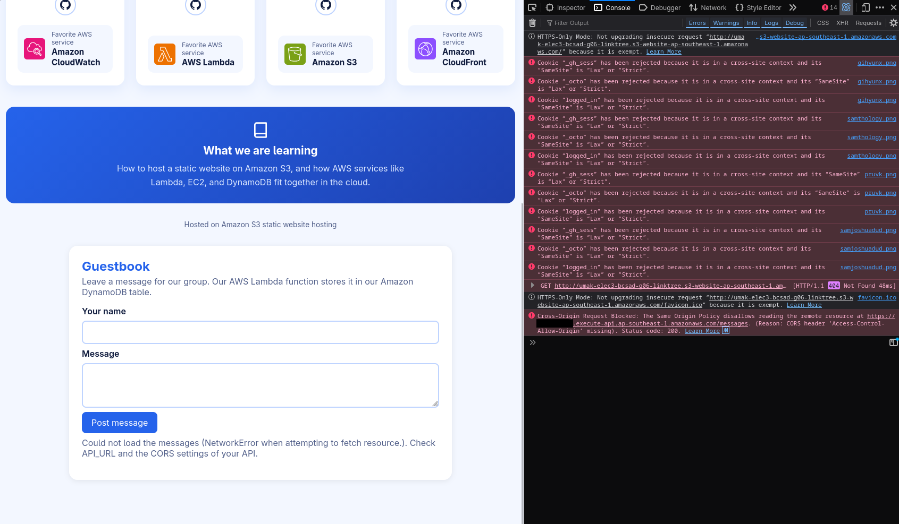
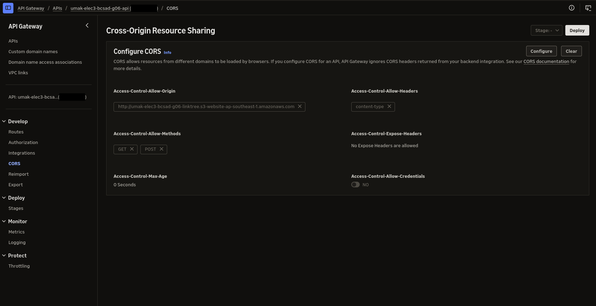
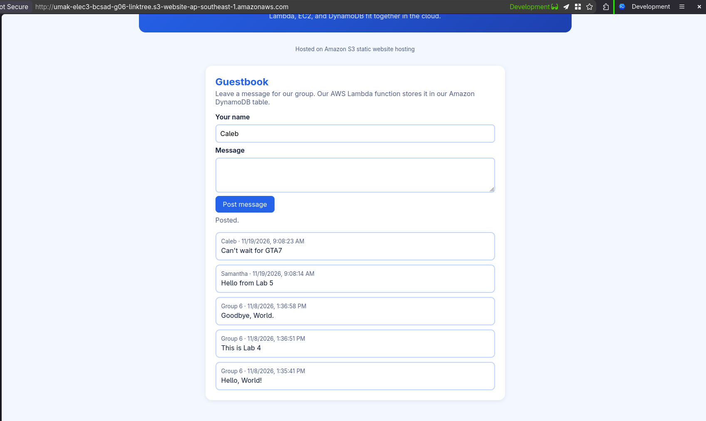
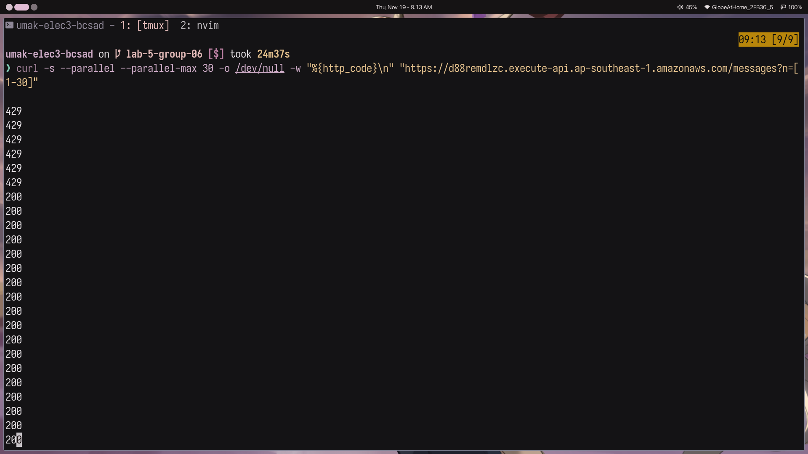

# Lab 5 Submission

<!--
How to use this template:

1. Copy this file to submissions/lab-5/group-<number>/submission.md
2. Replace every <answer> with your group's answer. Delete the angle brackets too.
3. Save cors-error.png, cors.png, site.png, and throttle.png in the same folder.
4. Crop the AWS console top bar out of cors.png, and cover every ARN.
5. Cover your API ID, the part between https:// and .execute-api, in cors-error.png, cors.png, and throttle.png.
6. Do not add your index.html. It holds your invoke URL.
7. Do not write full names or student numbers in this file.
-->

## About us

- Group number: 6
- Section: IV-BCSAD
- Group IAM user: bcsad-g06
- Website endpoint: http://umak-elec3-bcsad-g06-linktree.s3-website-ap-southeast-1.amazonaws.com
- HTTP API name: umak-elec3-bcsad-g06-api

## Screenshots

## Questions

1. In Lab 4, your API answered `curl` and the address bar of your browser. In Step 3, the same API did not answer your page. Why?

   CORS (Cross-Origin Resource Sharing) is a rule that the browser enforces only on scripts that run on a page. Our page comes from one origin (`http` at the S3 website host) and our API from another (`https` at the `execute-api` host), so the browser blocked the `fetch` call because the API did not send an `Access-Control-Allow-Origin` header that allows our site. `curl` and the address bar are not scripts on a page, so the browser rule did not apply to them and they got the answer.

2. Which pillar of the AWS Well-Architected Framework does your throttle serve? Explain in two sentences.

   The throttle serves the Reliability pillar, because it keeps a flood of requests from anyone who reads our invoke URL from overwhelming our Lambda function and DynamoDB table, so the API stays available for real visitors. API Gateway answers the extra requests with `429 Too Many Requests` before they reach the function, which also keeps the cost from growing with the flood.

3. Your guestbook shows each message with `textContent`. What could a visitor do if the page put each message into the page as HTML with `innerHTML`?

   A visitor could post a message that holds HTML or a script, such as ``, and it would run in the browser of every person who opens our page. This is stored cross-site scripting (XSS), where the attacker could change the page, send visitors to another site, or use our page to post messages or call our API on their behalf.
