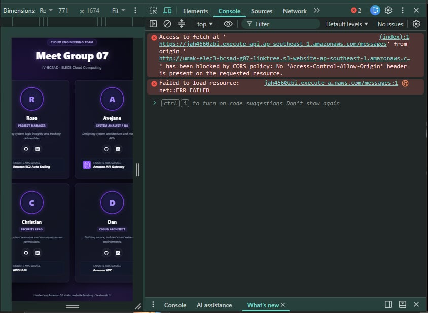
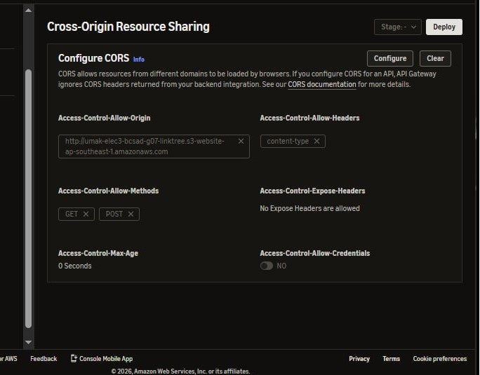
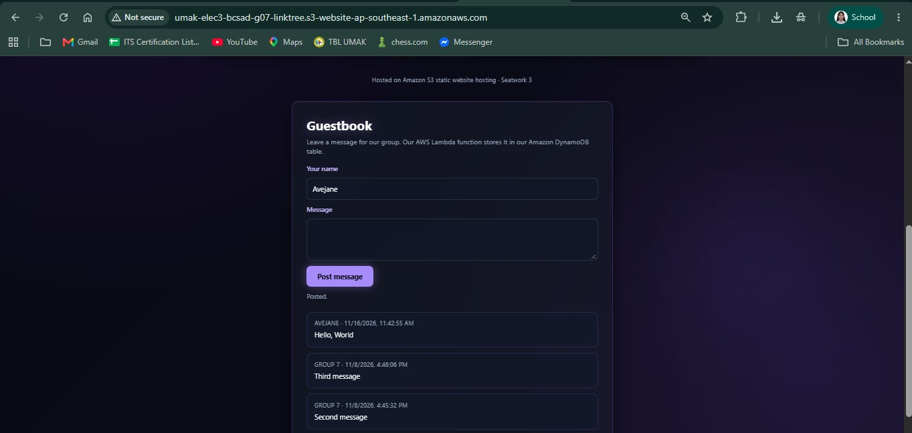
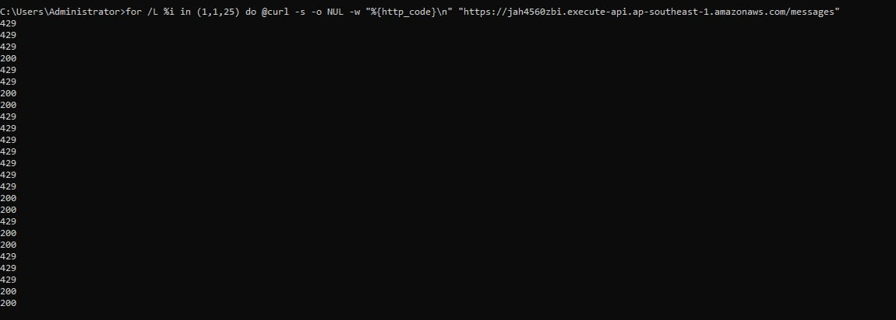

## About us

- Group number: 07
- Section: IV-BCSAD
- Group IAM user: bcsad-g07
- Website endpoint: http://umak-elec3-bcsad-g07-linktree.s3-website-ap-southeast-1.amazonaws.com
- HTTP API name: umak-elec3-bcsad-g07-api

## Screenshots

## Questions

1. In Lab 4, your API answered `curl` and the address bar of your browser. In Step 3, the same API did not answer your page. Why?

    Browsers enforce the Same-Origin Policy (SOP), which blocks web applications loaded from an S3 static website origin from making cross-origin requests to a different API Gateway origin unless explicit Cross-Origin Resource Sharing (CORS) headers (`Access-Control-Allow-Origin`) are present in the server's response. While `curl` bypasses browser SOP restrictions, the browser blocked the response because API Gateway did not initially return the required CORS headers.

2. Which pillar of the AWS Well-Architected Framework does your throttle serve? Explain in two sentences.

    API throttling serves the Reliability pillar of the AWS Well-Architected Framework by protecting backend services from traffic spikes and overload conditions. By limiting request rates, it ensures stable and predictable performance for legitimate users under heavy loads.

3. Your guestbook shows each message with `textContent`. What could a visitor do if the page put each message into the page as HTML with `innerHTML`?

    If the page used `innerHTML` instead of `textContent`, a malicious visitor could inject and execute arbitrary client-side JavaScript code (Stored Cross-Site Scripting or XSS) through the guestbook message field. This could allow attackers to steal session tokens, hijack user sessions, or manipulate the webpage content for anyone viewing the guestbook.
