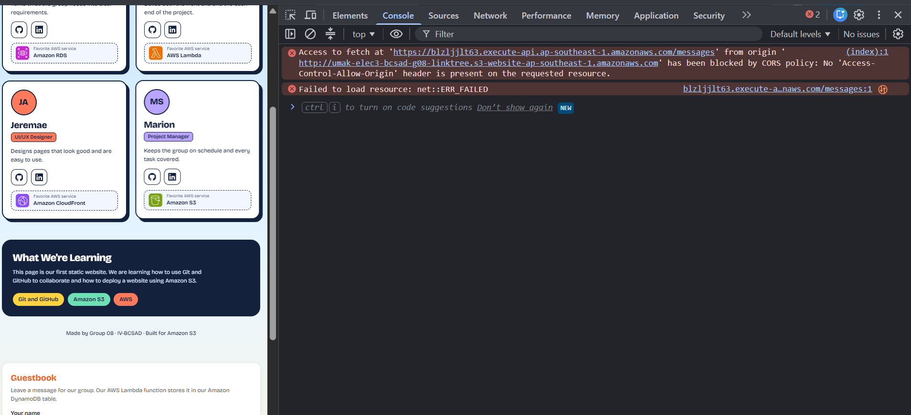
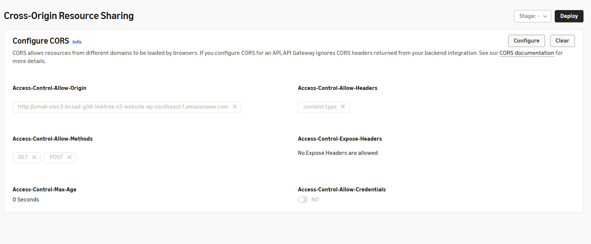
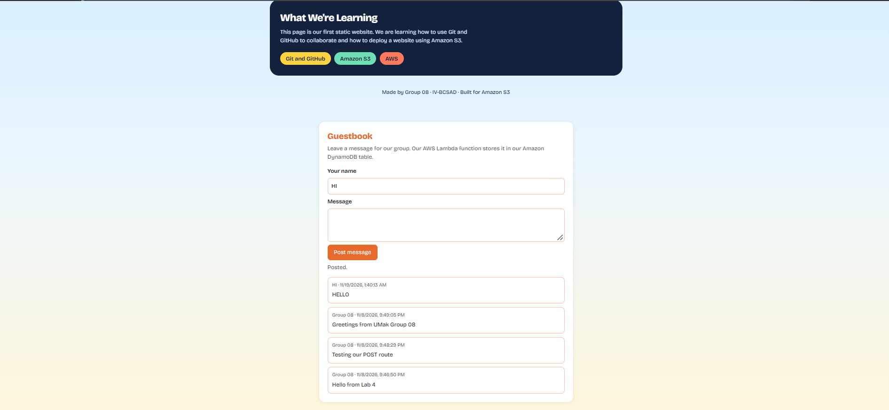
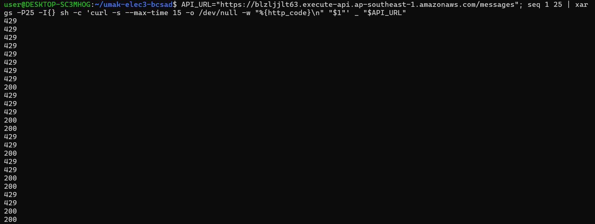

# Lab 5 Submission

## About us

- Group number: 08
- Section: IV-BCSAD
- Group IAM user: bcsad-g08
- Website endpoint:  http://umak-elec3-bcsad-g08-linktree.s3-website-ap-southeast-1.amazonaws.com
- HTTP API name: umak-elec3-bcsad-g08-api

## Screenshots

## Questions

1. In Lab 4, your API answered `curl` and the address bar of your browser. In Step 3, the same API did not answer your page. Why?

   The API worked with curl and the browser's address bar because these requests were not restricted by the browser's Cross-Origin Resource Sharing (CORS) policy. However, when the website accessed the API from a different origin, the browser checked whether cross-origin requests were allowed. Since CORS was not yet configured, the browser blocked the response.

2. Which pillar of the AWS Well-Architected Framework does your throttle serve? Explain in two sentences.

   The throttle primarily supports the Reliability pillar of the AWS Well-Architected Framework. It helps prevent the API from being overwhelmed by excessive requests, maintaining its availability and performance during periods of high traffic.

3. Your guestbook shows each message with `textContent`. What could a visitor do if the page put each message into the page as HTML with `innerHTML`?

   Using innerHTML could expose the website to Cross-Site Scripting (XSS) attacks. A malicious visitor could submit a message containing harmful HTML or JavaScript that might execute when other users view the guestbook, potentially stealing information or performing unwanted actions.
