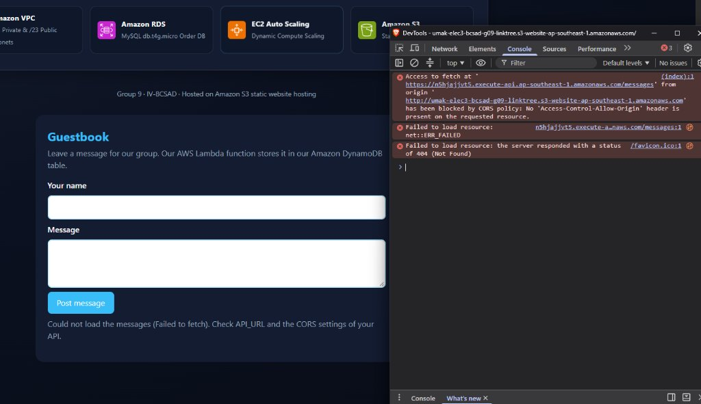
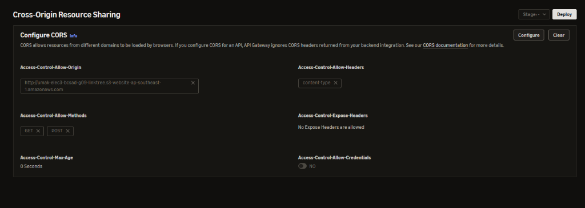
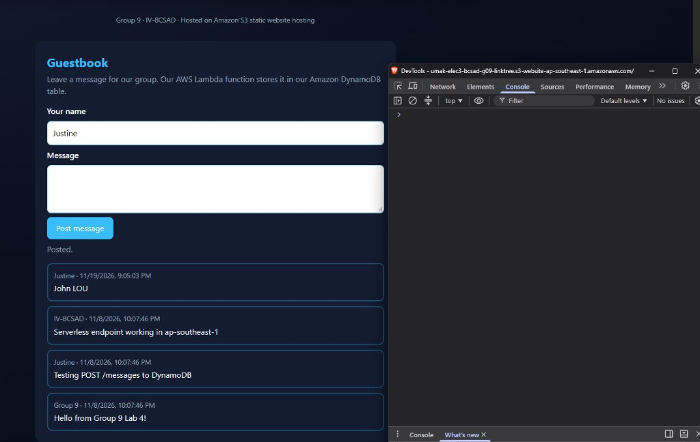
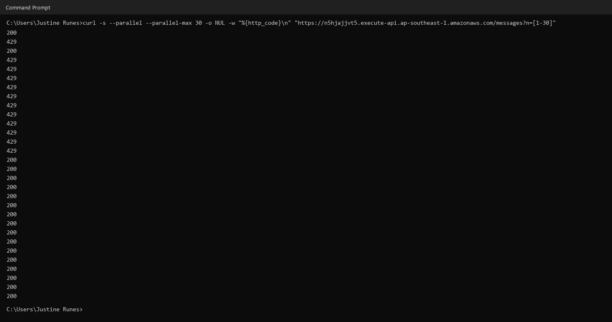

# Lab 5 Submission

<!--
How to use this template:

1. Copy this file to submissions/lab-5/group-<number>/submission.md
2. Replace every <answer> with your group's answer. Delete the angle brackets too.
3. Save cors-error.png, cors.png, site.png, and throttle.png in the same folder.
4. Crop the AWS console top bar out of cors.png, and cover every ARN.
5. Cover your API ID, the part between https:// and .execute-api, in cors-error.png, cors.png, and throttle.png.
6. Do not add your index.html. It holds your invoke URL.
7. Do not write full names or student numbers in this file.
-->

## About us

- Group number: 9
- Section: IV-BCSAD
- Group IAM user: bcsad-g09
- Website endpoint: http://umak-elec3-bcsad-g09-linktree.s3-website-ap-southeast-1.amazonaws.com
- HTTP API name: umak-elec3-bcsad-g09-api

## Screenshots

## Questions

1. In Lab 4, your API answered `curl` and the address bar of your browser. In Step 3, the same API did not answer your page. Why?

   In Step 3, the request was made by JavaScript (`fetch`) running on our S3 website (`http://umak-elec3-bcsad-g09-linktree.s3-website-ap-southeast-1.amazonaws.com`) to our API Gateway endpoint (`https://<api-id>.execute-api.ap-southeast-1.amazonaws.com`), which is a **cross-origin request** because their schemes (`http` vs. `https`) and hosts (`s3-website` vs. `execute-api`) differ. Browsers enforce Cross-Origin Resource Sharing (CORS) on scripts running inside a web page and blocked the response because our API did not yet return an `Access-Control-Allow-Origin` header allowing our S3 origin, whereas `curl` and typing the URL directly into the browser address bar are not cross-origin page scripts so CORS restrictions do not apply to them.

2. Which pillar of the AWS Well-Architected Framework does your throttle serve? Explain in two sentences.

   Our `$default` stage throttle primarily serves the **Reliability** pillar (alongside **Security** and **Cost Optimization**) of the AWS Well-Architected Framework by protecting our API, Lambda function, and DynamoDB table from traffic floods or abusive scripts. When incoming traffic exceeds our token-bucket burst limit of 5 requests and steady rate of 2 requests per second, API Gateway immediately returns `429 Too Many Requests` without invoking Lambda, preserving backend availability for normal visitors and preventing unexpected serverless charges.

3. Your guestbook shows each message with `textContent`. What could a visitor do if the page put each message into the page as HTML with `innerHTML`?

   If the guestbook rendered messages with `innerHTML` instead of `textContent`, a visitor could post a message containing malicious HTML and JavaScript (for example, `` or ``) to execute a **Stored Cross-Site Scripting (XSS)** attack. Because the message is stored in DynamoDB and loaded by every visitor's browser, the injected script would automatically run in the browser of everyone who opens our group site, enabling the attacker to deface the page, redirect visitors, spam the API, or steal browser data.

