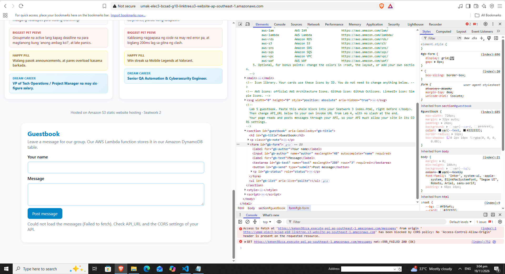
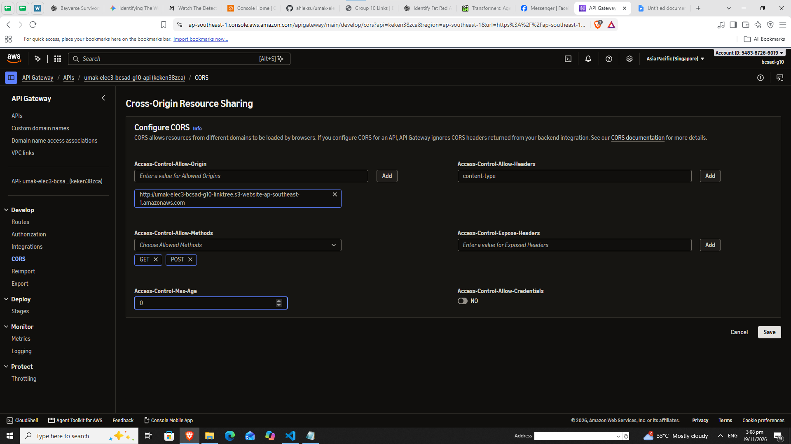
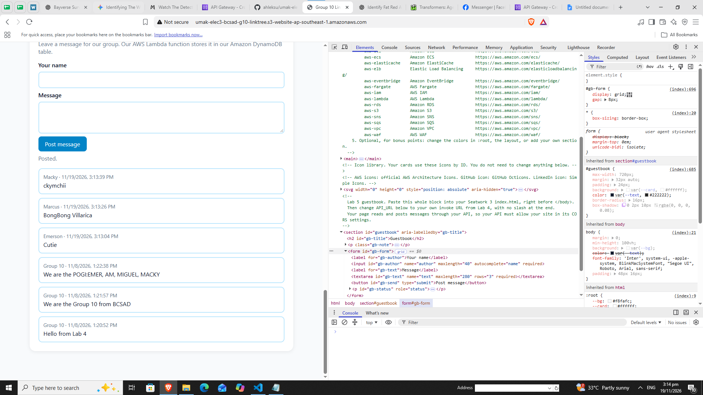
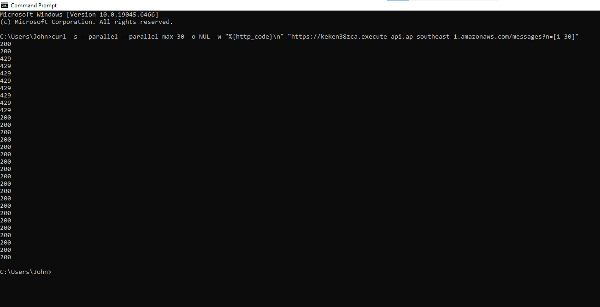

# Lab 5 Submission

<!--
How to use this template:

1. Copy this file to submissions/lab-5/group-<number>/submission.md
2. Replace every <answer> with your group's answer. Delete the angle brackets too.
3. Save cors-error.png, cors.png, site.png, and throttle.png in the same folder.
4. Crop the AWS console top bar out of cors.png, and cover every ARN.
5. Cover your API ID, the part between https:// and .execute-api, in cors-error.png, cors.png, and throttle.png.
6. Do not add your index.html. It holds your invoke URL.
7. Do not write full names or student numbers in this file.
-->

## About us

- Group number: 10
- Section: IV-BCSAD
- Group IAM user: bcsad-g10
- Website endpoint: http://umak-elec3-bcsad-g10-linktree.s3-website-ap-southeast-1.amazonaws.com
- HTTP API name: umak-elec3-bcsad-g10-api

## Screenshots

## Questions

1. In Lab 4, your API answered `curl` and the address bar of your browser. In Step 3, the same API did not answer your page. Why?

CORS (Cross-Origin Resource Sharing) is a security mechanism enforced by web browsers on client-side scripts. In Step 3, the JavaScript `fetch` script was executed from the web page's origin (`http://umak-elec3-bcsad-g10-linktree.s3-website-ap-southeast-1.amazonaws.com`) making requests to a different API origin (`https://...execute-api.ap-southeast-1.amazonaws.com`). Because the API had not yet configured the `Access-Control-Allow-Origin` header to permit that origin, the browser's Same-Origin Policy blocked the script from reading the response. In contrast, `curl` and the browser address bar are not client-side scripts running inside a web origin, so browser CORS restrictions do not apply to them.

2. Which pillar of the AWS Well-Architected Framework does your throttle serve? Explain in two sentences.

The throttle serves the **Reliability** pillar (and also reinforces the **Security** pillar). By enforcing rate and burst limits with a token bucket, it protects API Gateway, Lambda, and DynamoDB from being exhausted by unexpected traffic spikes, aggressive client loops, or Denial of Service (DoS) floods. This ensures consistent service availability and prevents downstream system overload.

3. Your guestbook shows each message with `textContent`. What could a visitor do if the page put each message into the page as HTML with `innerHTML`?

If `innerHTML` were used, an attacker could inject arbitrary HTML and malicious JavaScript (for example `<script>` tags or ``), causing a Stored Cross-Site Scripting (XSS) vulnerability. When other visitors view the guestbook, their browsers would execute the injected code in the context of their session, enabling the attacker to steal cookies/tokens, redirect users to malicious websites, or alter the page layout. Using `textContent` safely renders all input as inert plain text.
