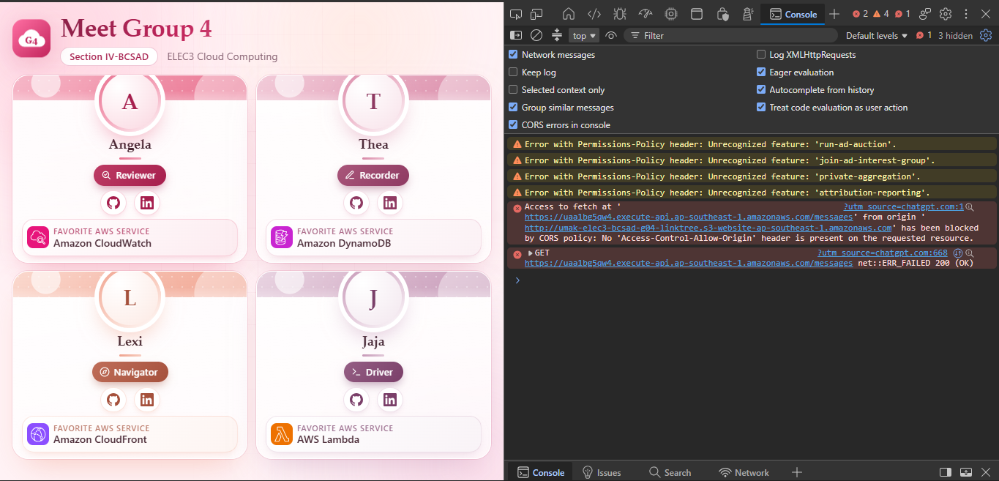
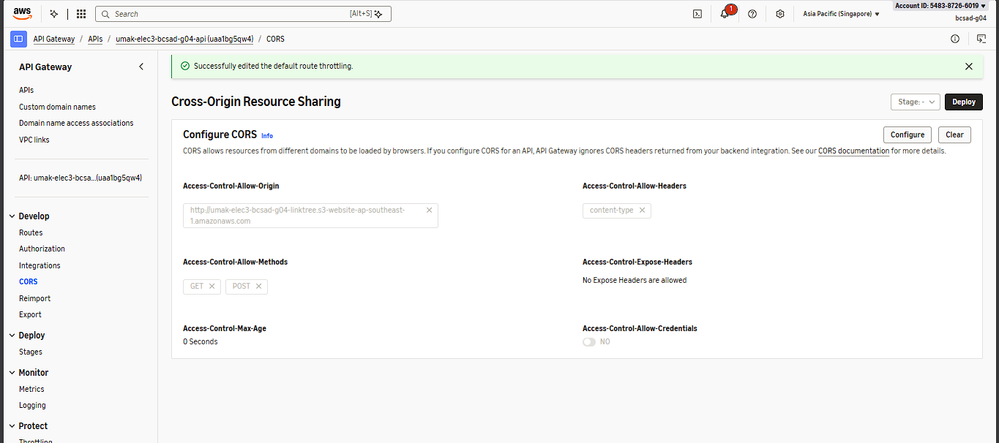
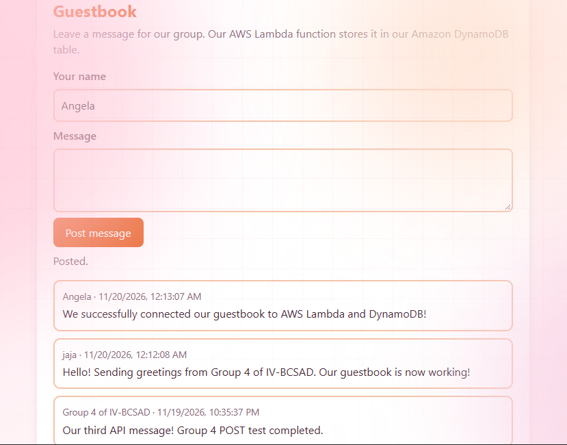
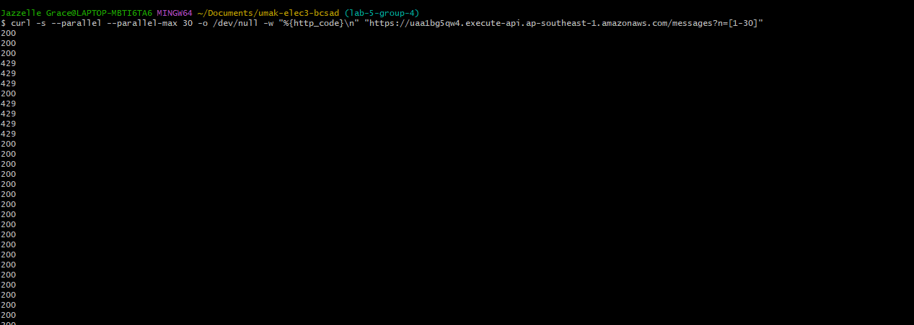

# Lab 5 Submission

## About us

- Group number: 4
- Section: IV-BCSAD
- Group IAM user: bcsad-g04
- Website endpoint: http://umak-elec3-bcsad-g04-linktree.s3-website-ap-southeast-1.amazonaws.com
- HTTP API name: umak-elec3-bcsad-g04-api

## Screenshots

## Questions

1. In Lab 4, your API answered `curl` and the address bar of your browser. In Step 3, the same API did not answer your page. Why?

   The API worked with `curl` and the browser address bar because those requests are not subject to the browser's JavaScript cross-origin restrictions. The webpage's JavaScript `fetch()` request was blocked because the API had not yet allowed the website's origin through CORS.

2. Which pillar of the AWS Well-Architected Framework does your throttle serve? Explain in two sentences.

   The throttle supports the Reliability pillar of the AWS Well-Architected Framework. It limits excessive requests so the API and its backend services are less likely to become overloaded and can remain responsive.

3. Your guestbook shows each message with `textContent`. What could a visitor do if the page put each message into the page as HTML with `innerHTML`?

   If the page used `innerHTML`, a visitor could submit malicious HTML or JavaScript that the browser executes when other visitors view the guestbook. This could lead to cross-site scripting (XSS), allowing attackers to manipulate the page or perform harmful actions.
