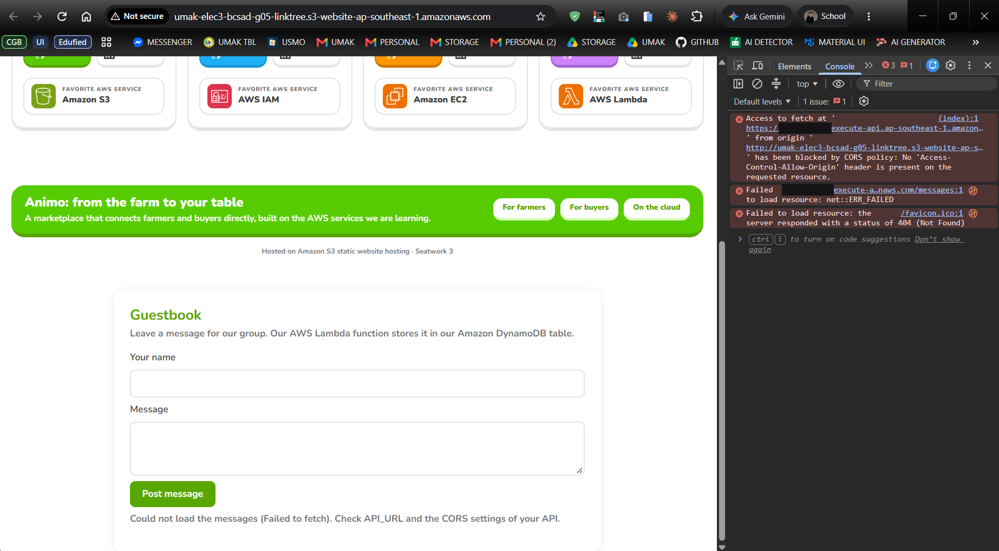
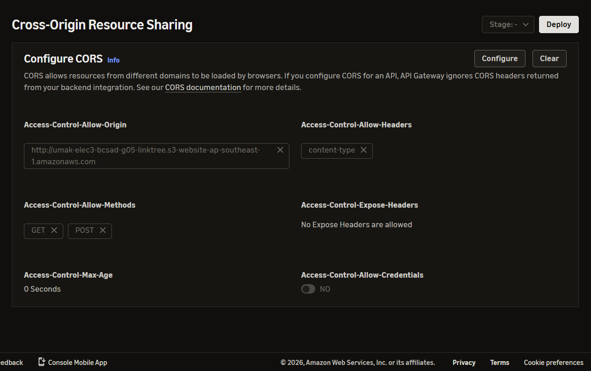
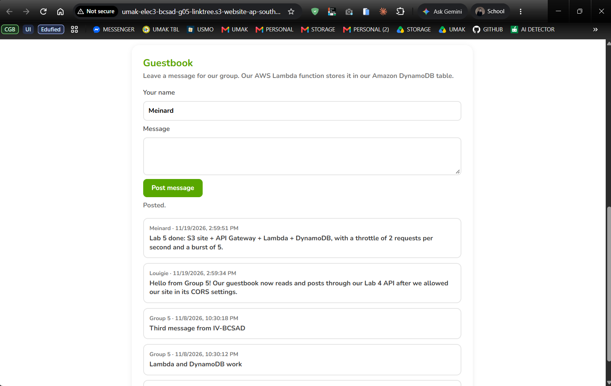
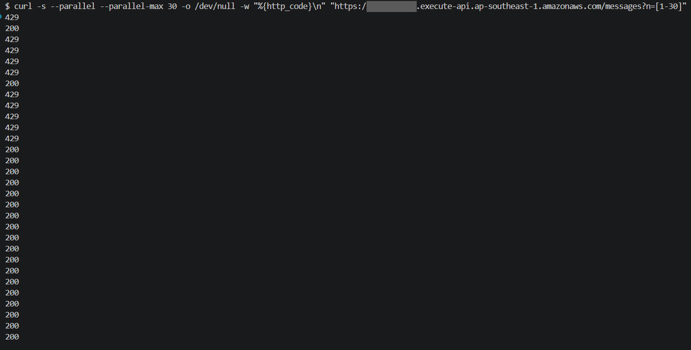

# Lab 5 Submission

## About us

- Group number: 5
- Section: IV-BCSAD
- Group IAM user: bcsad-g05
- Website endpoint: http://umak-elec3-bcsad-g05-linktree.s3-website-ap-southeast-1.amazonaws.com
- HTTP API name: umak-elec3-bcsad-g05-api

## Screenshots

## Questions

1. In Lab 4, your API answered `curl` and the address bar of your browser. In Step 3, the same API did not answer your page. Why?

   CORS is a rule that the browser applies to scripts on a page, not a rule of the API. `curl` is not a browser, and when we typed the URL in the address bar, the browser opened the API itself as a page, so in both cases no script on another origin asked for the answer and CORS did not apply. In Step 3, the guestbook script on our page, at the origin `http://umak-elec3-bcsad-g05-linktree.s3-website-ap-southeast-1.amazonaws.com`, called our API at a different origin, `https://<API ID>.execute-api.ap-southeast-1.amazonaws.com`, with a different scheme and host. Our API did not yet send an `Access-Control-Allow-Origin` header that allows our site, so the browser blocked the page from reading the answer and showed the CORS error in the Console. The API itself still received the request and answered it. After we added our website endpoint, `GET`, `POST`, and `content-type` to the CORS settings, the browser let the page read the answers.

2. Which pillar of the AWS Well-Architected Framework does your throttle serve? Explain in two sentences.

   The throttle serves the Reliability pillar, because it limits our API to 2 requests per second with a burst of 5, so a flood of requests to our public invoke URL cannot overload our Lambda function and DynamoDB table and break the guestbook for real visitors. API Gateway answers the extra requests with `429 Too Many Requests` before they reach our function, which is the Reliability best practice of throttling requests to protect a workload.

3. Your guestbook shows each message with `textContent`. What could a visitor do if the page put each message into the page as HTML with `innerHTML`?

   A visitor could post a message that holds HTML with code in it, for example ``. Our table stores the message, and every visitor who opens our page would load it, so the browser would run that code on our page. This is stored cross-site scripting (XSS). The code could change or deface our page, send visitors to a fake page, steal what they type into the form, or make every visitor's browser post spam messages to our API. With `textContent`, the browser shows the message as plain text, so the same message appears as harmless characters and nothing runs.
