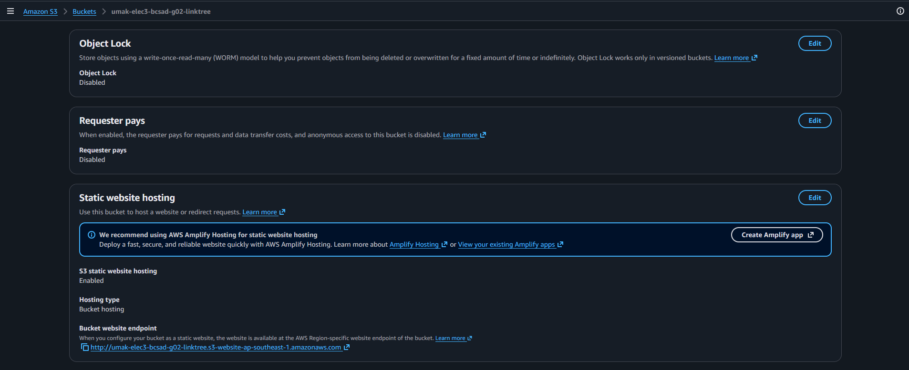
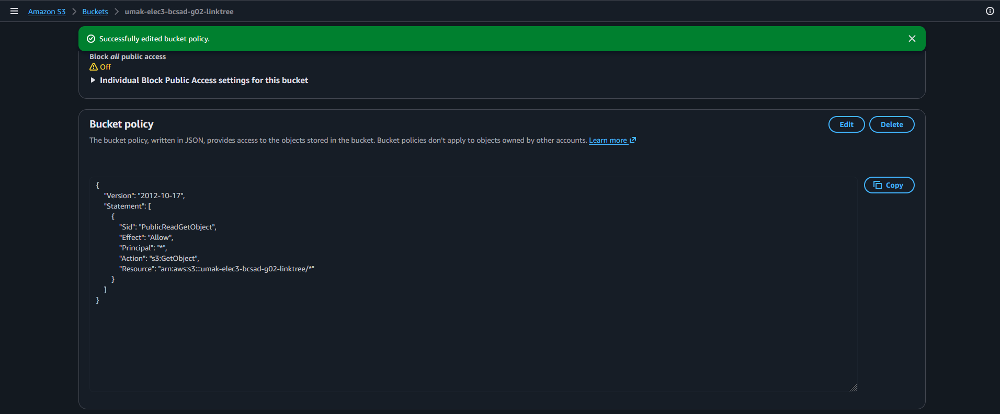
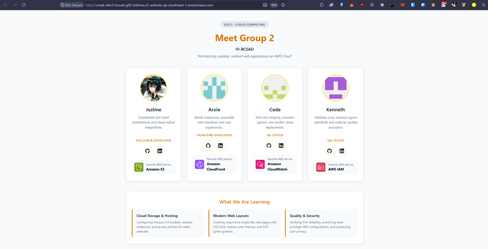

# Seatwork 3 Submission

## About us

- Group number: `group-02`
- Section: `IV-BCSAD`
- Group IAM user: `bcsad-g02`
- Bucket name: `umak-elec3-bcsad-g02-linktree`
- Website endpoint: http://umak-elec3-bcsad-g02-linktree.s3-website-ap-southeast-1.amazonaws.com

## Screenshots

## Contribution

| GitHub username | What this groupmate did |
| --- | --- |
| [justinecasiano](https://github.com/justinecasiano) | Created the S3 bucket in ap-southeast-1 with the required naming format and uploaded the Seatwork 2 index.html file. |
| [ExalaJohn](https://github.com/ExalaJohn) | Enabled static website hosting in bucket properties, configured index.html as the index document, and verified the generated endpoint. |
| [ShiftRedux](https://github.com/ShiftRedux) | Disabled Block Public Access for the website bucket and configured the public-read bucket policy allowing s3:GetObject. |
| [KennethTejam](https://github.com/KennethTejam) | Tested the live HTTP website endpoint in a browser, captured and cropped the required verification screenshots, and documented the submission. |
