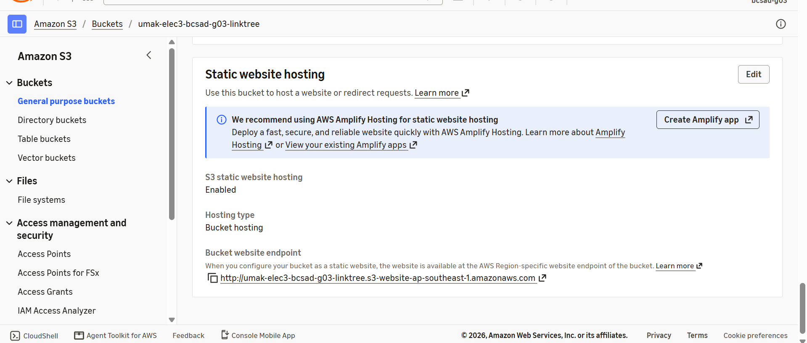
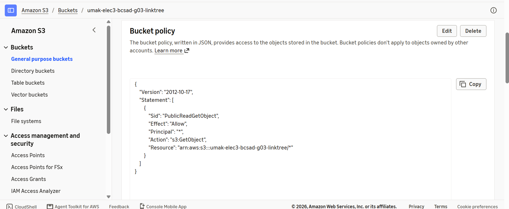
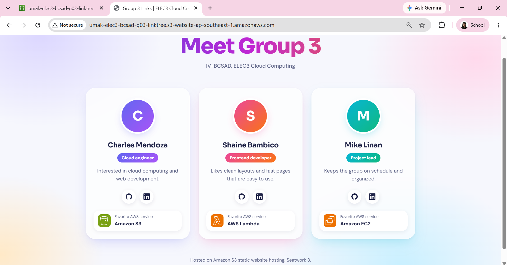

# Seatwork 3 Submission

## About us

- Group number: 03
- Section: IV-BCSAD
- Group IAM user: bcsad-g03
- Bucket name: umak-elec3-bcsad-g03-linktree
- Website endpoint: http://umak-elec3-bcsad-g03-linktree.s3-website-ap-southeast-1.amazonaws.com/

## Screenshots

## Contribution

| GitHub username | What this groupmate did |
| --- | --- |
| JHnsu | Managed Git operations, branch management, repository setup, and submission through GitHub. |
| kdotvalentino | Edited the group profile webpage using HTML and CSS. |
| shmoke4u | Prepared the webpage content, reviewed the code, tested hyperlinks, and checked the final output. |
