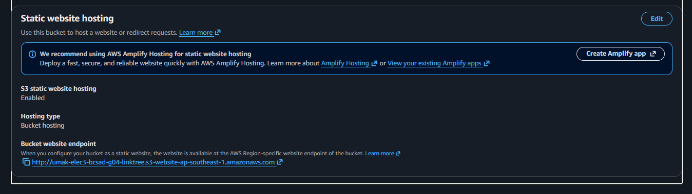
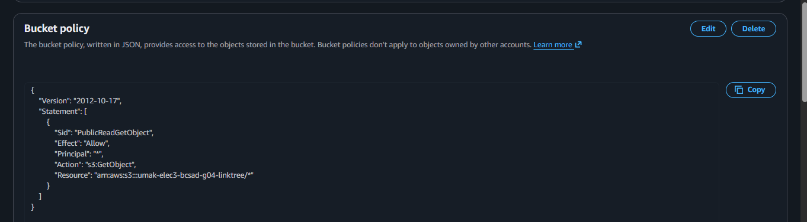
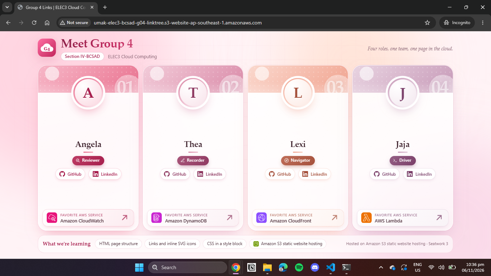

# Seatwork 3 Submission

## About us

- Group number: 04
- Section: IV-BCSAD
- Group IAM user: bcsad-g04
- Bucket name: umak-elec3-bcsad-g04-linktree
- Website endpoint: http://umak-elec3-bcsad-g04-linktree.s3-website-ap-southeast-1.amazonaws.com

## Screenshots

## Contribution

| GitHub username | What this groupmate did |
| --- | --- |
| leksxee | Configured S3 bucket, static website hosting, and bucket policy |
| username2 | Created and styled the index.html linktree page |
| username3 | Handled Git repository setup and pull request creation |