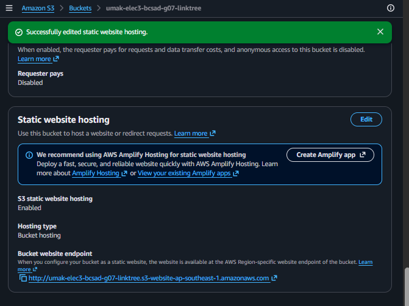
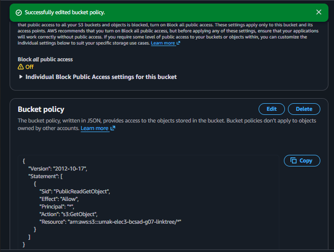
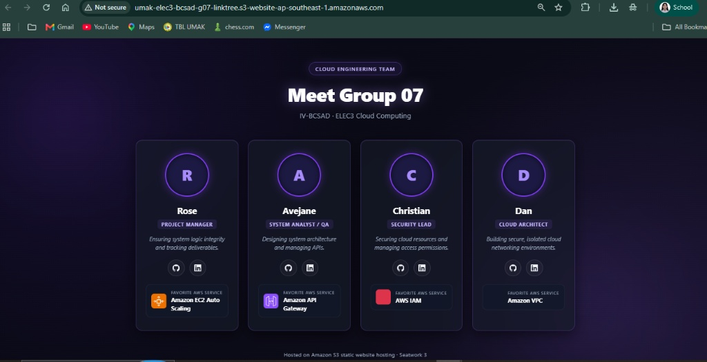

# Seatwork 3 Submission

## About us

* **Group number:** 07
* **Section:** IV-BCSAD
* **Group IAM user:** bcsad-g07
* **Bucket name:** umak-elec3-bcsad-g07-linktree
* **Website endpoint:** http://umak-elec3-bcsad-g07-linktree.s3-website-ap-southeast-1.amazonaws.com

## Screenshots

### Static website hosting with the endpoint

### Saved bucket policy

### Our page open in the browser

## Contribution

| GitHub username | What this groupmate did |
|-----------------|-------------------------|
| abijeyn | System analysis, QA testing, and S3 static website deployment |
| Dan-ike | Repository management and AWS S3 bucket configuration |
| StarMirai | HTML styling verification and public access policy setup |
| o4o29 | Documentation review, endpoint validation, and QA testing |