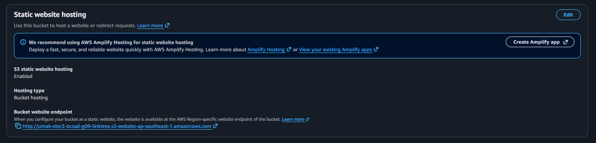
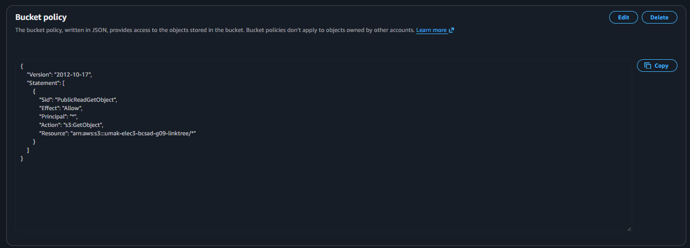
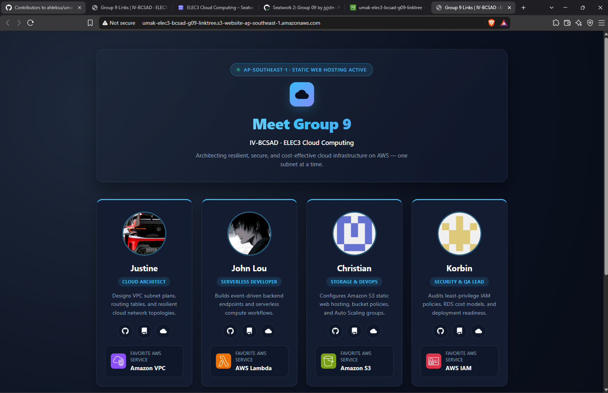

# Seatwork 3 Submission

<!--
How to use this template:

1. Copy this file to submissions/seatwork-3/group-<number>/submission.md
2. Replace every <answer> with your group's answer. Delete the angle brackets too.
3. Save hosting.png, policy.png, and site.png in the same folder.
4. Crop the AWS console top bar out of hosting.png and policy.png.
5. Write GitHub usernames, not full names or student numbers.
-->

## About us

- Group number: 9
- Section: IV-BCSAD
- Group IAM user: bcsad-g09
- Bucket name: umak-elec3-bcsad-g09-linktree
- Website endpoint: http://umak-elec3-bcsad-g09-linktree.s3-website-ap-southeast-1.amazonaws.com

## Screenshots

## Contribution

| GitHub username | What this groupmate did                                                                    |
| --------------- | ------------------------------------------------------------------------------------------ |
| jyjstn          | Created the S3 bucket in Singapore, uploaded `index.html`, and enabled static web hosting  |
| Dyeel           | Turned off Block Public Access for the bucket and configured the `s3:GetObject` policy     |
| Ychannn29       | Tested the public S3 website endpoint and captured/cropped the three required screenshots  |
| korbin88        | Completed `submission.md`, verified all bucket settings and links, and submitted the PR    |

