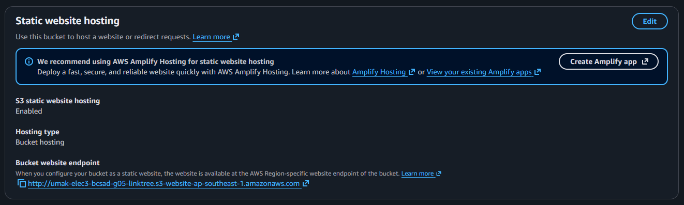
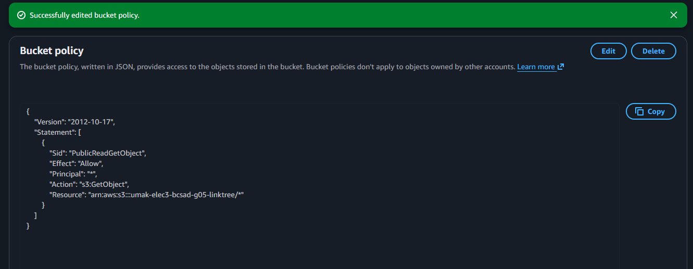
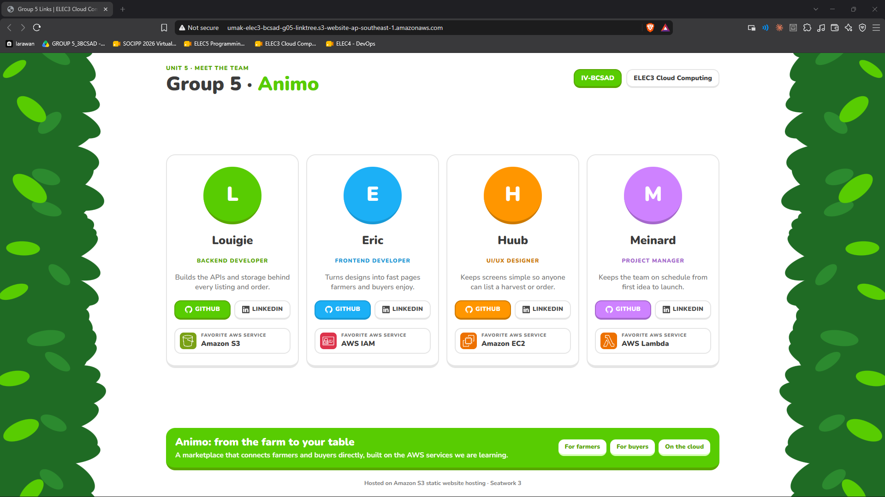

# Seatwork 3 Submission

<!--
How to use this template:

1. Copy this file to submissions/seatwork-3/group-<number>/submission.md
2. Replace every <answer> with your group's answer. Delete the angle brackets too.
3. Save hosting.png, policy.png, and site.png in the same folder.
4. Crop the AWS console top bar out of hosting.png and policy.png.
5. Write GitHub usernames, not full names or student numbers.
-->

## About us

- Group number: 5
- Section: IV-BCSAD
- Group IAM user: bcsad-g05
- Bucket name: umak-elec3-bcsad-g05-linktree
- Website endpoint: http://umak-elec3-bcsad-g05-linktree.s3-website-ap-southeast-1.amazonaws.com

## Screenshots

## Contribution

| GitHub username | What this groupmate did |
| --- | --- |
| LouieCads | Created the S3 bucket and uploaded the page. |
| ehrickkk | Turned on static website hosting and set the index document. |
| sonisunn | Turned off Block Public Access, added the bucket policy, and took the screenshots. |
| MeinardEdrei | Tested the website endpoint and checked the submission. |
