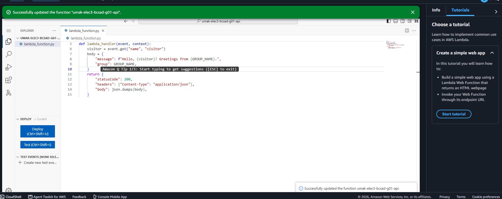
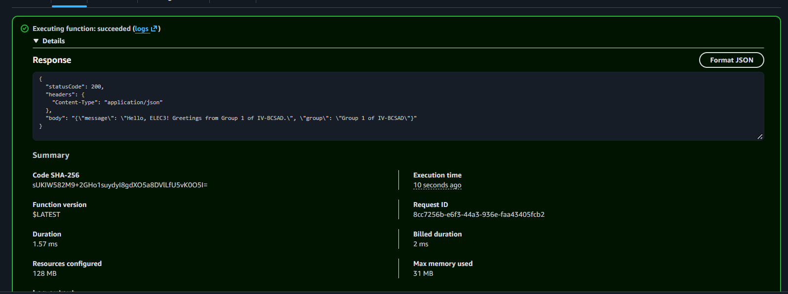
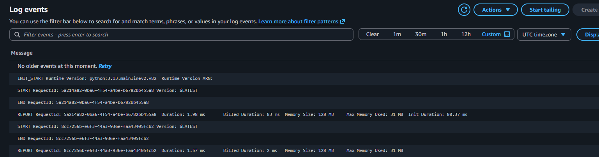

# Seatwork 4 Submission

<!--
How to use this template:

1. Copy this file to submissions/seatwork-4/group-<number>/submission.md
2. Replace every <answer> with your group's answer. Delete the angle brackets too.
3. Save code.png, test.png, and report.png in the same folder.
4. Crop the AWS console top bar out of all three screenshots, and cover every ARN.
5. Write GitHub usernames, not full names or student numbers.
-->

## About us

- Group number: 1
- Section: IV-BCSAD
- Group IAM user: bcsad-g01
- Function name: umak-elec3-bcsad-g01-api

## Handler code

```
import json

GROUP_NAME = "Group 1 of IV-BCSAD"  # Change this to your group's name.


def lambda_handler(event, context):
    visitor = event.get("name", "visitor")
    body = {
        "message": f"Hello, {visitor}! Greetings from {GROUP_NAME}.",
        "group": GROUP_NAME,
    }
    return {
        "statusCode": 200,
        "headers": {"Content-Type": "application/json"},
        "body": json.dumps(body),
    }
```

## REPORT lines

First run, a cold start:

```
REPORT RequestId: 5a214a82-0ba6-4f54-a4be-b6782bb455a8	Duration: 1.98 ms	Billed Duration: 83 ms	Memory Size: 128 MB	Max Memory Used: 31 MB	Init Duration: 80.37 ms
```

Second run, a warm start:

```
REPORT RequestId: 6cde35ac-85c2-4c86-9825-3aa42bca2aae	Duration: 6.37 ms	Billed Duration: 7 ms	Memory Size: 128 MB	Max Memory Used: 31 MB
```

## Question

Why does the second REPORT line have no Init Duration?

The second run was a warm start. Lambda reused the environment from the first run, so it did not need to do the setup (init) again. The first run was a cold start, so it had to do the setup and its REPORT line shows an Init Duration.

## Screenshots







## Contribution

| GitHub username | What this groupmate did                                       |
| --------------- | ------------------------------------------------------------- |
| mrkjeniel       | Created the Lambda function                                   |
| MalulanM        | Wrote and deployed the handler code, and ran the test event   |
| JohnJhayAdriano | Found the REPORT lines and took the screenshots |
| qinglow         | Filled in submission.md and made the pull request             |