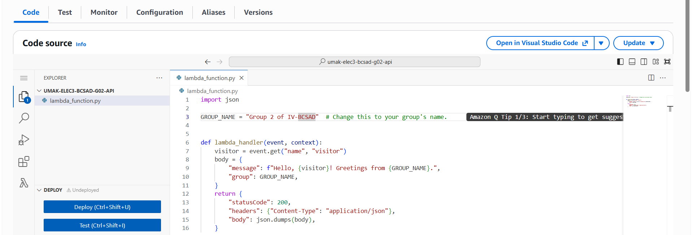
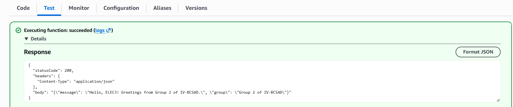
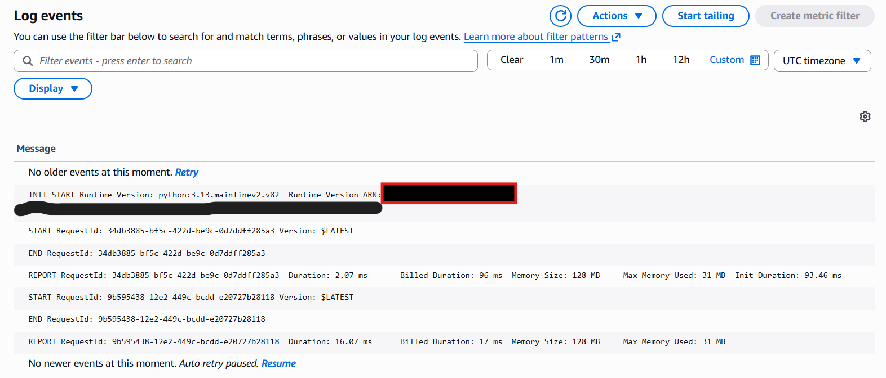

# Seatwork 4 Submission

<!--
How to use this template:

1. Copy this file to submissions/seatwork-4/group-<number>/submission.md
2. Replace every <answer> with your group's answer. Delete the angle brackets too.
3. Save code.png, test.png, and report.png in the same folder.
4. Crop the AWS console top bar out of all three screenshots, and cover every ARN.
5. Write GitHub usernames, not full names or student numbers.
-->

## About us

- Group number: 02
- Section: IV-BCSAD
- Group IAM user: bcsad-g02
- Function name: umak-elec3-bcsad-g02-api

## Handler code

```python
import json

GROUP_NAME = "Group 2 of IV-BCSAD"  # Change this to your group's name.


def lambda_handler(event, context):
    visitor = event.get("name", "visitor")
    body = {
        "message": f"Hello, {visitor}! Greetings from {GROUP_NAME}.",
        "group": GROUP_NAME,
    }
    return {
        "statusCode": 200,
        "headers": {"Content-Type": "application/json"},
        "body": json.dumps(body),
    }
```

## REPORT lines

First run, a cold start:

```text
REPORT RequestId: 34db3885-bf5c-422d-be9c-0d7ddff285a3	Duration: 2.07 ms	Billed Duration: 96 ms	Memory Size: 128 MB	Max Memory Used: 31 MB	Init Duration: 93.46 ms	
```

Second run, a warm start:

```text
REPORT RequestId: 9b595438-12e2-449c-bcdd-e20727b28118	Duration: 16.07 ms	Billed Duration: 17 ms	Memory Size: 128 MB	Max Memory Used: 31 MB	
```

## Question

Why does the second REPORT line have no Init Duration?

The first test was a cold start, so Lambda needed time to create the execution environment and load the code, which is recorded as the Init Duration. The second test was a warm start that ran inside the same environment, so it did not need to initialize again.

## Screenshots







## Contribution

| GitHub username | What this groupmate did |
| --- | --- |
| KennethTejam | Captured and sanitized the console screenshots, double-checked region/naming rules, and finalized the submission writeup. |
| ShiftRedux | Executed the test events, retrieved the CloudWatch execution metrics, and drafted the question response. |
| justinecasiano | Configured the Lambda runtime and permissions in AWS and updated the handler code. |
| ExalaJohn | Managed the Git workflow, created the seatwork branch, and handled file organization. |