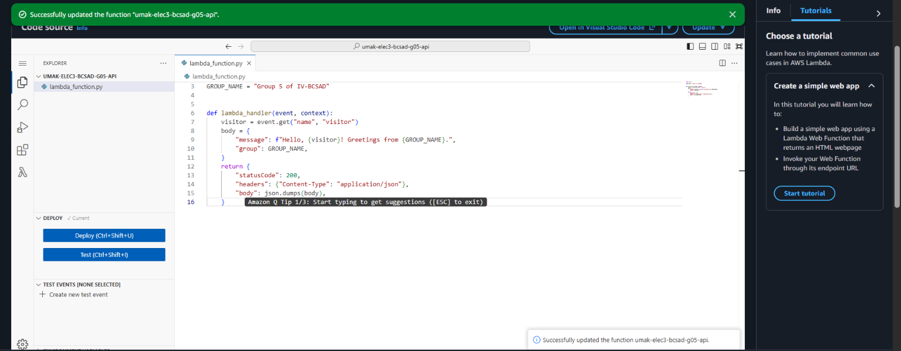
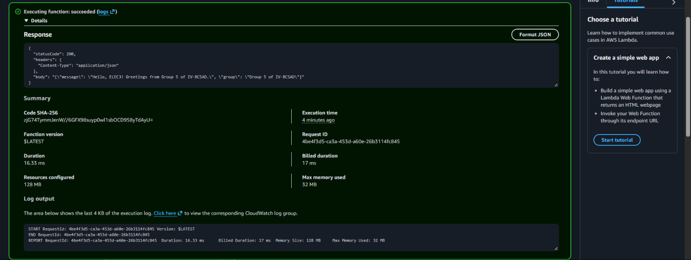
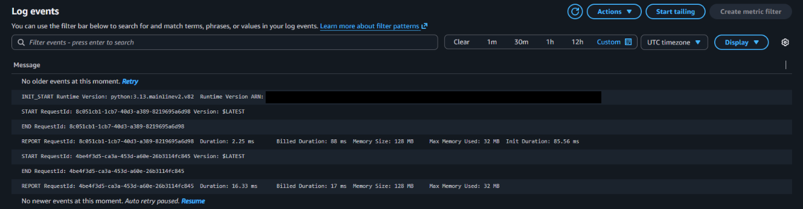

# Seatwork 4 Submission

<!--
How to use this template:

1. Copy this file to submissions/seatwork-4/group-<number>/submission.md
2. Replace every <answer> with your group's answer. Delete the angle brackets too.
3. Save code.png, test.png, and report.png in the same folder.
4. Crop the AWS console top bar out of all three screenshots, and cover every ARN.
5. Write GitHub usernames, not full names or student numbers.
-->

## About us

- Group number: 5
- Section: IV-BCSAD
- Group IAM user: bcsad-g05
- Function name: umak-elec3-bcsad-g05-api

## Handler code

```python
import json

GROUP_NAME = "Group 5 of IV-BCSAD"


def lambda_handler(event, context):
    visitor = event.get("name", "visitor")
    body = {
        "message": f"Hello, {visitor}! Greetings from {GROUP_NAME}.",
        "group": GROUP_NAME,
    }
    return {
        "statusCode": 200,
        "headers": {"Content-Type": "application/json"},
        "body": json.dumps(body),
    }
```

## REPORT lines

First run, a cold start:

```text
REPORT RequestId: 8c051cb1-1cb7-40d3-a389-8219695a6d98	Duration: 2.25 ms	Billed Duration: 88 ms	Memory Size: 128 MB	Max Memory Used: 32 MB	Init Duration: 85.56 ms
```

Second run, a warm start:

```text
REPORT RequestId: 4be4f3d5-ca3a-453d-a60e-26b3114fc845	Duration: 16.33 ms	Billed Duration: 17 ms	Memory Size: 128 MB	Max Memory Used: 32 MB
```

## Question

Why does the second REPORT line have no Init Duration?

The second run was a warm start. Lambda kept the execution environment from the first run and reused it, so Python was already started and our code was already loaded. There was no init step to time. Init Duration appears only on a cold start, when Lambda creates a new environment and loads the code.

## Screenshots







## Contribution

| GitHub username | What this groupmate did |
| --- | --- |
| LouieCads | Created the function with the group role, took the screenshots, and filled in this submission |
| ehrickkk | Wrote and deployed the handler, ran the test event twice |
| MeinardEdrei | Found both REPORT lines in CloudWatch |
| sonisunn | Ran the test event twice |
