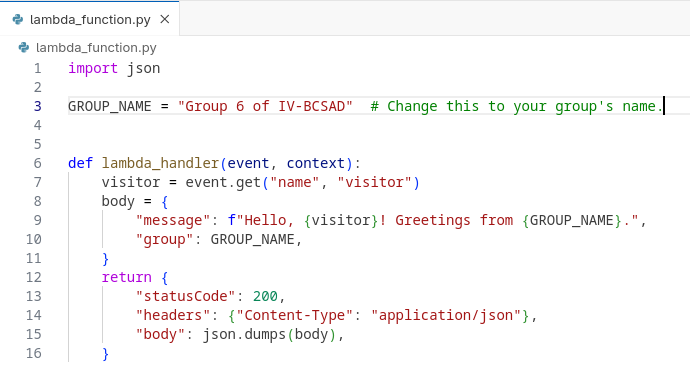
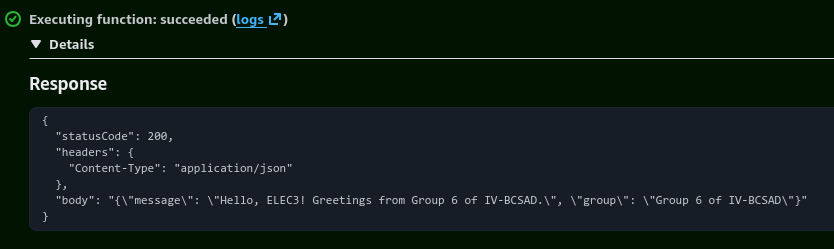
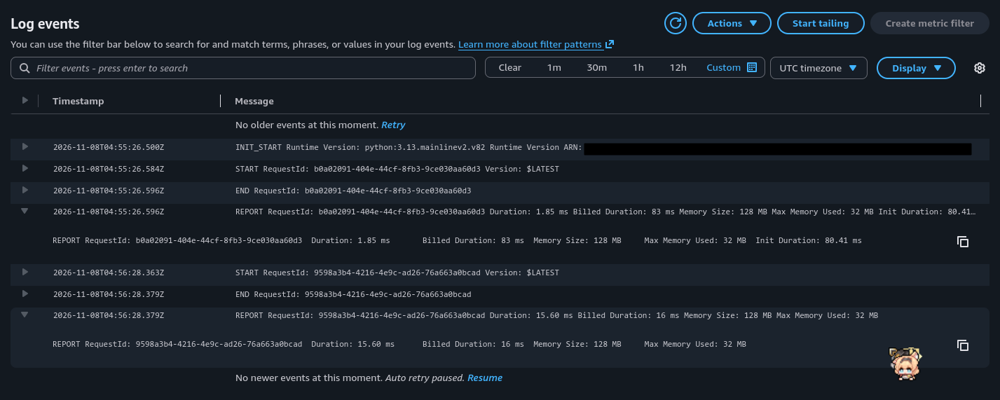

# Seatwork 4 Submission

<!--
How to use this template:

1. Copy this file to submissions/seatwork-4/group-<number>/submission.md
2. Replace every <answer> with your group's answer. Delete the angle brackets too.
3. Save code.png, test.png, and report.png in the same folder.
4. Crop the AWS console top bar out of all three screenshots, and cover every ARN.
5. Write GitHub usernames, not full names or student numbers.
-->

## About us

- Group number: 6
- Section: IV-BCSAD
- Group IAM user: bcsad-g06
- Function name: umak-elec3-bcsad-g06-api

## Handler code

```python
import json

GROUP_NAME = "Group 6 of IV-BCSAD"  # Change this to your group's name.


def lambda_handler(event, context):
    visitor = event.get("name", "visitor")
    body = {
        "message": f"Hello, {visitor}! Greetings from {GROUP_NAME}.",
        "group": GROUP_NAME,
    }
    return {
        "statusCode": 200,
        "headers": {"Content-Type": "application/json"},
        "body": json.dumps(body),
    }
```

## REPORT lines

First run, a cold start:

```text
REPORT RequestId: b0a02091-404e-44cf-8fb3-9ce030aa60d3	Duration: 1.85 ms	Billed Duration: 83 ms	Memory Size: 128 MB	Max Memory Used: 32 MB	Init Duration: 80.41 ms
```

Second run, a warm start:

```text
REPORT RequestId: 9598a3b4-4216-4e9c-ad26-76a663a0bcad	Duration: 15.60 ms	Billed Duration: 16 ms	Memory Size: 128 MB	Max Memory Used: 32 MB
```

## Question

Why does the second REPORT line have no Init Duration?

The first invocation was a cold start, so Lambda had to initialize the execution environment and reported that time as `Init Duration`. The second invocation reused the already initialized environment (warm start), so it had no initialization time to report.

## Screenshots







## Contribution

| GitHub username | What this groupmate did                                               |
| --------------- | --------------------------------------------------------------------- |
| gihyunx         | Manage repository and initiate the AWS Lambda function setup.         |
| samthology      | Distributed tasks and validated document answers and screenshots.     |
| samjoshuadud    | Assisted in Navigating the AWS console during task execution.         |
| pruvk           | Validated the AWS configuration is correct based on the instructions. |
