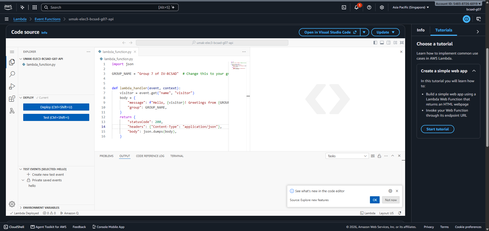
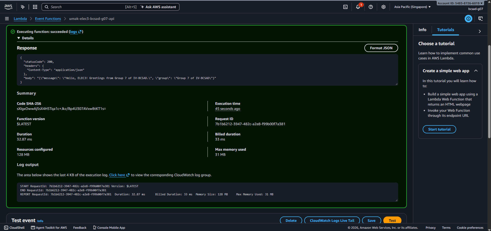
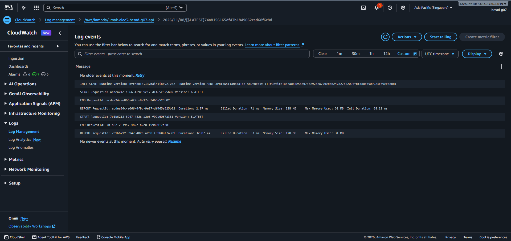

# Seatwork 4 Submission

<!--
How to use this template:

1. Copy this file to submissions/seatwork-4/group-<number>/submission.md
2. Replace every <answer> with your group's answer. Delete the angle brackets too.
3. Save code.png, test.png, and report.png in the same folder.
4. Crop the AWS console top bar out of all three screenshots, and cover every ARN.
5. Write GitHub usernames, not full names or student numbers.
-->

## About us

- Group number: 07
- Section: IV-BCSAD
- Group IAM user: bcsad-g07
- Function name: umak-elec3-bcsad-g07-api

## Handler code

```python
import json

GROUP_NAME = "Group 7 of IV-BCSAD"  # Change this to your group's name.


def lambda_handler(event, context):
    visitor = event.get("name", "visitor")
    body = {
        "message": f"Hello, {visitor}! Greetings from {GROUP_NAME}.",
        "group": GROUP_NAME,
    }
    return {
        "statusCode": 200,
        "headers": {"Content-Type": "application/json"},
        "body": json.dumps(body),
    }
```

## REPORT lines

First run, a cold start:

```text
REPORT RequestId: acdea24c-e066-4f9c-9e17-df465e525b02	Duration: 2.07 ms	Billed Duration: 71 ms	Memory Size: 128 MB	Max Memory Used: 31 MB	Init Duration: 68.11 ms	
```

Second run, a warm start:

```text
REPORT RequestId: 7b1b6212-3947-482c-a2e8-f99b00f7a381	Duration: 32.87 ms	Billed Duration: 33 ms	Memory Size: 128 MB	Max Memory Used: 31 MB	
```

## Question

Why does the second REPORT line have no Init Duration?

- The first run was a cold start. Lambda had to create a new execution environment, start Python, and load our code, and that setup time is shown as Init Duration (68.11 ms) in the first REPORT line.
- Lambda kept that environment after the first run, so the second run, right after it, was a warm start that reused it. Nothing needed to be initialized, so Init Duration is not shown in the second REPORT line.
- This is also why the first run was billed for 71 ms, which includes the init time, while the second was billed for only 33 ms.

## Screenshots







## Contribution

| GitHub username | What this groupmate did |
| --- | --- |
| abijeyn | Created and configured the AWS Lambda function using Python 3.13 and the assigned group execution role. |
| Dan-Ike | Wrote, customized, and deployed the Python Lambda handler code with the group's name. |
| StarMirai | Created the test event, executed the Lambda function twice, and verified the successful test results. |
| o4o29 | Checked the CloudWatch logs, collected both REPORT lines, and helped prepare the screenshots and final submission. |
