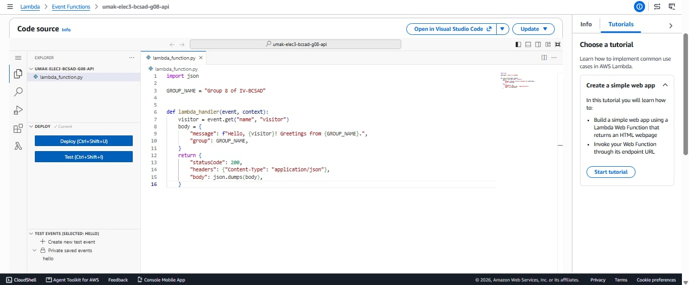
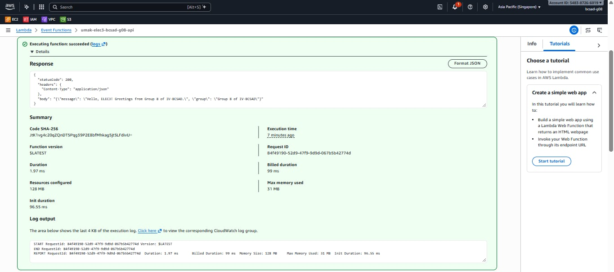
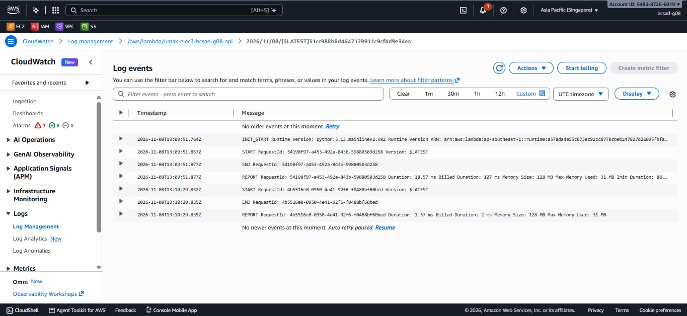

# Seatwork 4 Submission

<!--
How to use this template:

1. Copy this file to submissions/seatwork-4/group-<number>/submission.md
2. Replace every <answer> with your group's answer. Delete the angle brackets too.
3. Save code.png, test.png, and report.png in the same folder.
4. Crop the AWS console top bar out of all three screenshots, and cover every ARN.
5. Write GitHub usernames, not full names or student numbers.
-->

## About us

- Group number: 08
- Section: IV-BCSAD
- Group IAM user: bcsad-g08
- Function name: umak-elec3-bcsad-g08-api

## Handler code

```python
import json

GROUP_NAME = "Group 8 of IV-BCSAD"


def lambda_handler(event, context):
    visitor = event.get("name", "visitor")
    body = {
        "message": f"Hello, {visitor}! Greetings from {GROUP_NAME}.",
        "group": GROUP_NAME,
    }
    return {
        "statusCode": 200,
        "headers": {"Content-Type": "application/json"},
        "body": json.dumps(body),
    }
```

## REPORT lines

First run, a cold start:

```text
REPORT RequestId: 54198f97-a453-492a-843b-59880503d258 Duration: 18.57 ms Billed Duration: 107 ms Memory Size: 128 MB Max Memory Used: 31 MB Init Duration: 88.34 ms
```

Second run, a warm start:

```text
REPORT RequestId: 4b5516e0-0950-4e41-92f6-f0488bf60bed Duration: 1.57 ms Billed Duration: 2 ms Memory Size: 128 MB Max Memory Used: 31 MB
```

## Question

Why does the second REPORT line have no Init Duration?

The second REPORT line has no Init Duration because Lambda reused the already initialized execution environment from the first invocation. Since the environment was already prepared, Lambda did not need to perform the initialization process again.

## Screenshots







## Contribution

| GitHub username | What this groupmate did |
| --- | --- |
| julienaulolsayu | Created and tested the Lambda function. |
| PorkAdubuu | Helped with the Lambda code and testing. |
| chuulinnn | Helped check the function and its output |
| marionnn10 | Helped prepare the screenshots and submission |
