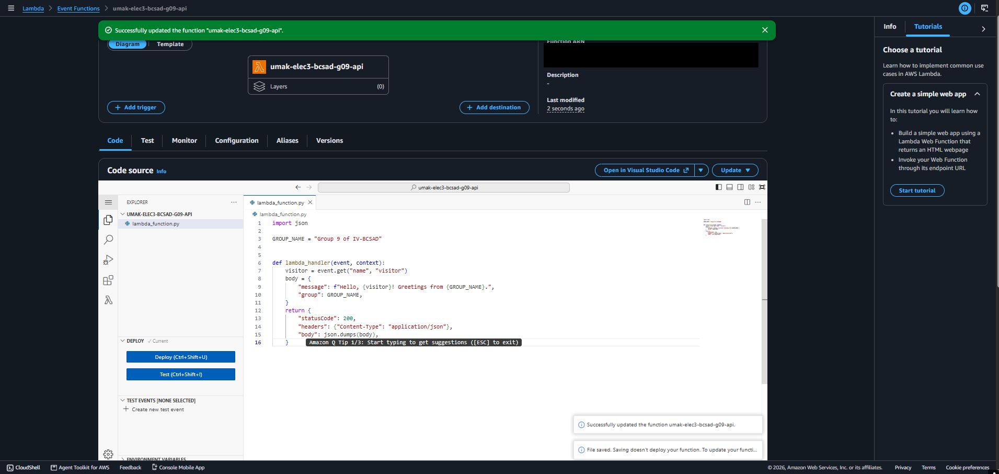
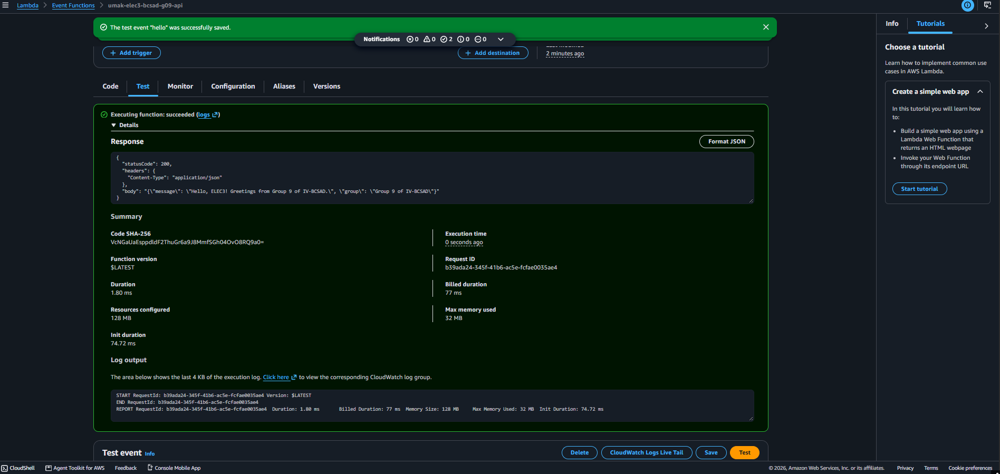
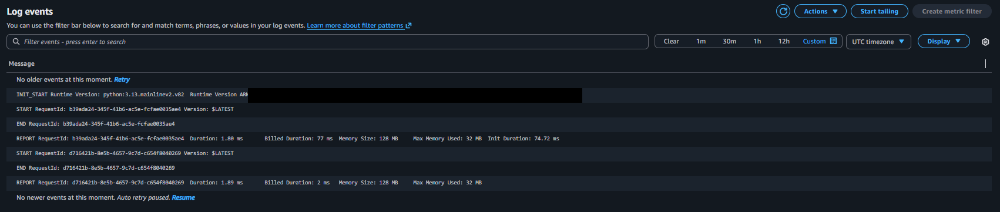

# Seatwork 4 Submission

<!--
How to use this template:

1. Copy this file to submissions/seatwork-4/group-<number>/submission.md
2. Replace every <answer> with your group's answer. Delete the angle brackets too.
3. Save code.png, test.png, and report.png in the same folder.
4. Crop the AWS console top bar out of all three screenshots, and cover every ARN.
5. Write GitHub usernames, not full names or student numbers.
-->

## About us

- Group number: 9
- Section: IV-BCSAD
- Group IAM user: bcsad-g09
- Function name: umak-elec3-bcsad-g09-api

## Handler code

```python
import json

GROUP_NAME = "Group 9 of IV-BCSAD"


def lambda_handler(event, context):
    visitor = event.get("name", "visitor")
    body = {
        "message": f"Hello, {visitor}! Greetings from {GROUP_NAME}.",
        "group": GROUP_NAME,
    }
    return {
        "statusCode": 200,
        "headers": {"Content-Type": "application/json"},
        "body": json.dumps(body),
    }
```

## REPORT lines

First run, a cold start:

```text
REPORT RequestId: b39ada24-345f-41b6-ac5e-fcfae0035ae4	Duration: 1.80 ms	Billed Duration: 77 ms	Memory Size: 128 MB	Max Memory Used: 32 MB	Init Duration: 74.72 ms
```

Second run, a warm start:

```text
REPORT RequestId: d716421b-8e5b-4657-9c7d-c654f8040269	Duration: 1.89 ms	Billed Duration: 2 ms	Memory Size: 128 MB	Max Memory Used: 32 MB
```

## Question

Why does the second REPORT line have no Init Duration?

The second run is a **warm start** that reuses the isolated execution environment created during the first (cold start) run. Because Lambda already started the Python 3.13 runtime and loaded our `lambda_function.py` handler code into memory during the first run, it did not need to initialize a new execution environment before invoking `lambda_handler` a second time, so there is no `Init Duration`.

## Screenshots







## Contribution

| GitHub username | What this groupmate did                                                                                   |
| --------------- | --------------------------------------------------------------------------------------------------------- |
| jyjstn          | Created the `umak-elec3-bcsad-g09-api` Lambda function in Singapore with Python 3.13 and our group's role |
| Dyeel           | Wrote and deployed the `lambda_handler` greeting code and captured `code.png`                             |
| Ychannn29       | Configured the `hello` test event, ran the cold and warm start tests, and captured `test.png`             |
| korbin88        | Located the CloudWatch log stream, extracted both REPORT lines (`report.png`), and completed `submission.md` |

