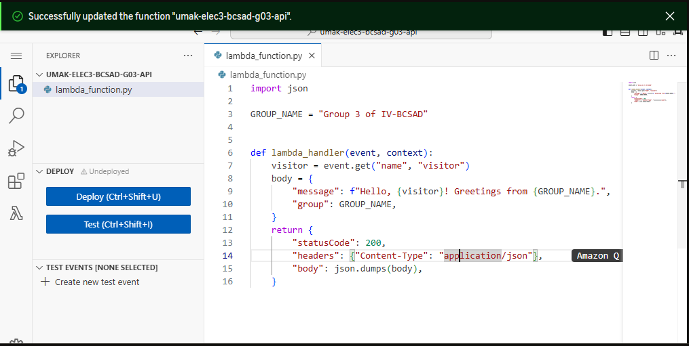
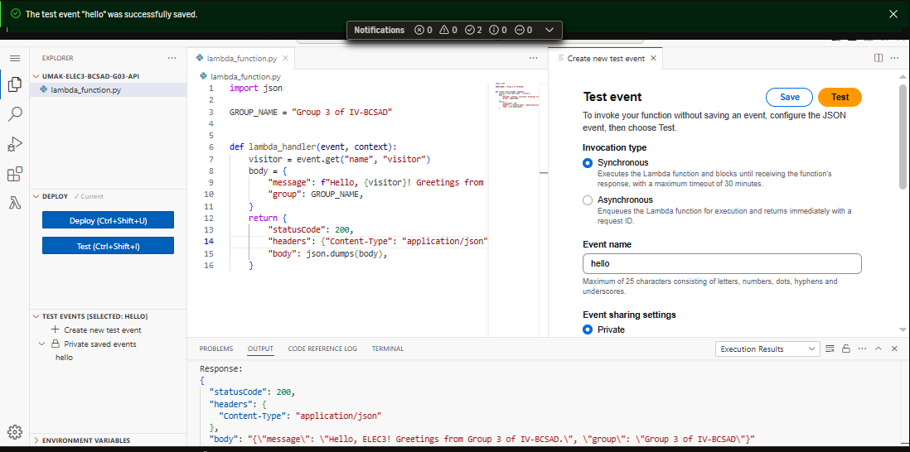
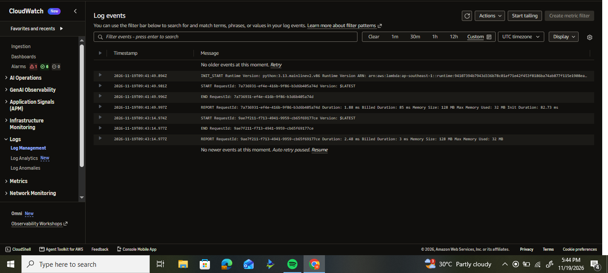

# Seatwork 4 Submission

## About us

- Group number: 3
- Section: IV-BCSAD
- Group IAM user: bcsad-g03
- Function name: umak-elec3-bcsad-g03-api

## Handler code

```python
import json

GROUP_NAME = "Group 3 of IV-BCSAD"


def lambda_handler(event, context):
    visitor = event.get("name", "visitor")
    body = {
        "message": f"Hello, {visitor}! Greetings from {GROUP_NAME}.",
        "group": GROUP_NAME,
    }
    return {
        "statusCode": 200,
        "headers": {"Content-Type": "application/json"},
        "body": json.dumps(body),
    }
```

## REPORT lines

First run, a cold start:

```text
REPORT RequestId: 7a736931-ef4e-416b-9f86-b5d05a74ad4d Duration: 1.88 ms Billed Duration: 85 ms Memory Size: 128 MB Max Memory Used: 32 MB Init Duration: 82.73 ms
```

Second run, a warm start:

```text
REPORT RequestId: 9ae7f211-f3a1-4991-9859-6cb5f69f9177c Duration: 2.48 ms Billed Duration: 3 ms Memory Size: 128 MB Max Memory Used: 32 MB
```

## Question

Why does the second REPORT line have no Init Duration?

The second run reused the Lambda execution environment created during the first run. Since the environment was already initialized, Lambda did not need to initialize it again, so no Init Duration was recorded. This is called a warm start.

## Screenshots







## Contribution

| GitHub username | What this groupmate did |
|---|---|
| kdotvalentino | Created the Lambda function, configured the execution role, and deployed the Python handler. |
| JHnsu | Configured the test event, executed the Lambda function, and verified the JSON response. |
| shmoke4u | Monitored CloudWatch Logs, recorded the REPORT lines, and prepared the screenshots and submission files. |